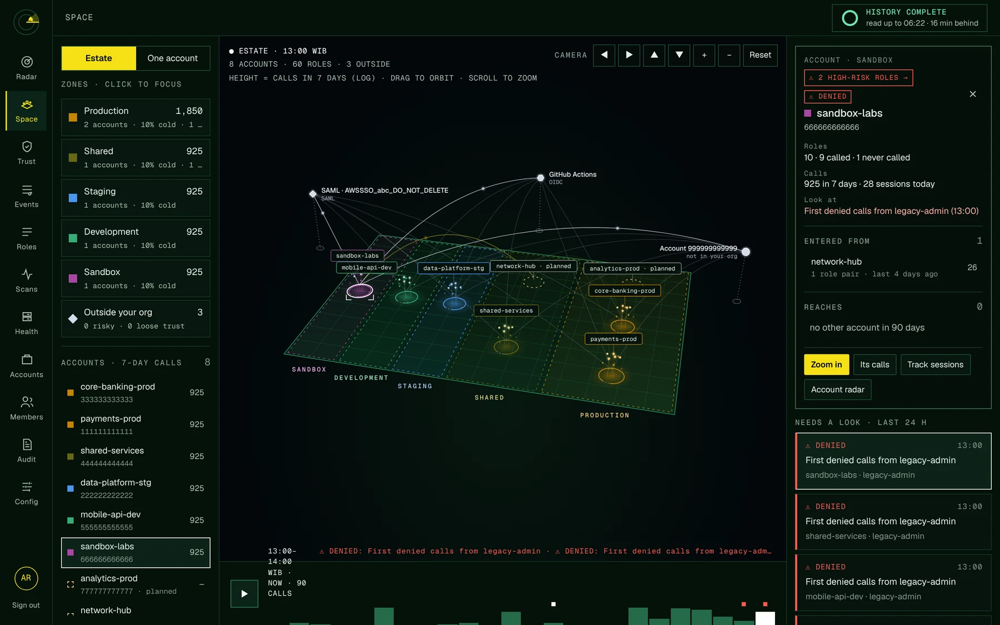

# Changelog

## Unreleased

### Added
- **History tab** on every role and IAM user: what changed on it, newest first, filtered by kind. Inventory now compares each identity with what is stored and records policies attached, detached or edited (before and after, with a line diff on the page; an AWS managed policy shows when AWS publishes a version), trust policy and permission boundary changes, keys deactivated or activated, MFA devices and console passwords added or removed, identities deleted or back. Analysis records risk level changes once an account's history is complete. Keys created and deleted, Radar's changes and every decision and approval (from the audit log) are merged in. New `GET /api/roles/:id/history` and `GET /api/roles/:id/history/:eventId`.
- **Access reviews (Reviews in the rail).** A frozen snapshot of the roles and IAM users in chosen accounts for a period: risk, permissions, calls and callers in the period, keys and console sign-in, every finding with its decision. Signed off once by each review team listed; a signed-off review cannot be removed. Identities CSV, decisions CSV, and a print layout to save as PDF. Audited as `review.create`, `review.signoff`, `review.delete`.
- **CSV downloads of the Roles and IAM users lists** (`/api/roles.csv`, `/api/iam-users.csv`), with the list's filters and the member's account scope. Cells starting with `= + - @` are escaped so spreadsheets do not run them.
- **Alerts (Admin → Alerts).** Rules that post to Slack or a webhook: a new finding at or above a severity, a Radar change (new caller, permissions gained, first denied calls… by kind), an access key past its rotation age, a console password without MFA, a failed scan. Each rule can be limited to environments and sends at once (checked every minute) or as a daily digest (`ALERT_DIGEST_AT`, 09:00 local). Matches found together go out as one message. Events count from when the rule is created or switched on (no backlog); conditions post what is true now once. One retry two minutes after a failure; a log of every message on the page. Destination URLs are stored encrypted and never returned; https only in production, no loopback or metadata addresses, no redirects followed. Changes are audited (`alert.*`). New tables `alert_destinations`, `alert_rules`, `alert_deliveries`, `alert_hits` (migration 027); the worker runs `alertsTick` under an advisory lock.
- **Risk thresholds are settings.** The access key rotation age and the unused age (both 90 days) are on Admin → Configuration and in `KEY_ROTATE_DAYS` / `KEY_UNUSED_DAYS`, instead of fixed in code. They drive IAM user findings and risk, the IAM users list, Google Cloud key findings and the key-age alert.
- **Search everything (`Ctrl K` / `⌘ K`).** From any page, or the *Search* button in the top bar: type a role, IAM user, access key ID, account name or ID, Google Cloud identity or page name, move with the arrows and press Enter. An access key opens its user's *Credentials* tab; an account opens its roles; *Events for "…"* searches every call. New `GET /api/search?q=`: up to 5 of each kind, exact names first, only in the accounts the member can see (no Google Cloud for members limited to some AWS accounts).
- **Findings inbox (Review → Findings).** Every open finding on the roles and IAM users a member can see, in one list: severity tiles that filter, type, account, roles or IAM users, *Needs a decision / Decided / All*, *My team's* (roles your review team signs off, and those both teams do) and search, all kept in the address. The selected finding's evidence and decision buttons sit beside the list, so deciding never leaves it. Tick several and decide them at once with one note, or clear their decisions. Keys: `j`/`k` move, `x` selects, `1`–`3` decide, `Esc` unselects, `/` searches. The rail shows how many findings wait for a decision. New `GET /api/findings`, `POST /api/findings/decisions` and `POST /api/findings/decisions/clear`: a bulk decision is all or nothing (every finding must be open, visible to the member and of a kind that takes the decision) and is audited once per finding as `flag.decide` with `bulk: true`. `GET /api/status` also returns `findings`, the waiting count.
- **IAM user monitoring.** A new *IAM users* page lists every user with each access key (ID, status, age, last use, rotate or deactivate badges), console password and MFA, groups and activity, with filters and sorting; a page per user adds CloudTrail activity per key, who used it in 30 days, roles it assumed and its policies (including its groups'). Users get the same permission analysis as roles, plus findings for old, unused or duplicate keys and console access without MFA.
- **Radar and Space: Show All | Roles | IAM users.** Users appear on both (squares in Space, their own sector on the account radar).
- The scanner policy now includes the IAM user, access key, MFA, login profile and group reads. Without them, users are skipped with a warning and stored users are kept.
- **Google Cloud (permissions only).** Connect an organization, folder or project with workload identity federation from the app's own AWS role or a service account key; generated `gcloud` commands, a test before saving, daily scans. Every identity's roles inherited down the hierarchy, its combined permissions, who can become each service account (keys, impersonation, actAs, key creation, GKE, federation) and findings (basic roles, IAM admin, mass impersonation, old keys, default service accounts with Editor, outside users, public grants, pools with no condition). Audit logs are not read yet.
- **Roles: AWS | Google Cloud tabs** on one page, and a page per Google identity with what it can do, where it comes from, who it can become and its paths to AWS.
- **Space: two fields.** AWS and Google Cloud on two planes with the same environment zones, and arcs where one cloud can sign in to the other (red when any AWS role can). Projects and cross-cloud paths have their own panels; AWS accounts list their Google Cloud paths.
- **Across clouds everywhere:** an AWS role's page lists where it reaches in Google Cloud and which Google service accounts it trusts; the Trust map names the Google service account a role trusts.
- **Password reset by an owner.** Members → *Reset password* makes a single-use link (24 hours, hash-only storage, token after the `#`) for the member to choose a new password. Using it signs them out everywhere and can reset their two-factor too. Owners only; audited as `member.password_reset_link` and `auth.password_reset`.
- **Single sign-on on the Configuration page.** Owners set OIDC there instead of only by environment variables, with a JumpCloud preset (issuer per region, scopes, group claim), the redirect and login URLs to copy, a *Check issuer* test and a warning when no group is mapped to a role. The client secret is stored encrypted and never returned. The sign-in button says which provider it is.
- **Light theme.** A sun/moon button in the top bar switches between the dark theme and a light one: the same design on pale mint paper with deep green ink, with banana kept for buttons and darkened to gold for text. The choice is kept per browser. Drawings (Space, Radar, Track, the sign-in radar) are mapped colour by colour, so every page follows the theme.
- **IAM Identity Center as one source.** Every account's `AWSSSO_<id>_DO_NOT_DELETE` SAML provider is matched to its Identity Center instance by the issuer in its metadata, and the Trust map and Space draw each instance once, with the account it is managed from.
- **Warnings for a second Identity Center.** An account that trusts more than one instance, or an instance other than the one most of your accounts use, is a high finding (`finding:idc-multiple`, `finding:idc-other`). Either can mean an account instance turned on inside a member account, or another organisation's.
- **Space: In, Out or Both.** A toggle shows only who can get into an account (outside identities, your other accounts, the scanner) or only where it can go. Paths between your accounts now include what trust policies allow, not only what was used: dashed when allowed but unused, red when the trust is risky.
- **Environments are yours to edit.** Add, rename, recolour, reorder or remove environments on the Configuration page. Removing one that accounts use asks where to move them.
- **Space: what you pick stands out.** Picking an account, role, service, outside identity or path keeps it and everything connected to it lit, and fades the rest. The page still opens with the whole scene lit.

### Fixed
- **Session replay did not light the calls as it played.** A name clash in the Track view (since the shared colour helper moved to `lib.js`) stopped the replay with an error.
- **Google Cloud scans failed on any project with GKE.** The scanner asked the GKE workload identity pool (`<project>.svc.id.goog`) for its providers, which Google refuses with a 400, and the whole scan stopped. Google-managed pools are now skipped, and a pool that cannot list its providers is skipped instead of failing the scan.

### Changed
- **Radar and the bell show one change feed.** The bell used to count Space's last 24 hours ("N TO LOOK AT") and, on Space, showed Space's own list; Radar showed 7 days. Now both read `GET /changes`: the bell shows what you have not seen ("N NEW"), with *Mark all as seen* and a link to Radar; Radar shows the same rows for a range of 24 hours, 7, 30 or 90 days (`?feed=`), new ones marked. Picking a change opens its role (its Activity tab for a new caller, History otherwise), or its account on Radar; on Space it is selected in the scene. What is new is tracked by change id per person (`users.changes_seen_id`, migration 029), so a change found late in older history still counts as new. `GET /space/flags` is removed.
- **Times are no longer fixed to WIB.** The workspace's zone is set on Admin → Configuration (*Time zone*, or `DISPLAY_TZ`; defaults to `SCAN_TZ`) and sent with the session. Each person can show times in their own browser's zone instead, from the menu on their avatar; the choice is kept in that browser. Labels follow the zone (WIB, WITA, WIT, or the browser's short name such as GMT+8). Scheduling (daily scan, alert digests) still uses `SCAN_TZ`.
- **Accounts page is a table.** One row per account with environment, status, how much history is read, roles and last scan. *Scan now* (or *Verify connection* when it is not connected) and *Edit* are on the row; Radar, Trust map, Event history, Unidentified calls, Identities and Remove are in its *More* menu. Clicking a row opens what the card used to show (why it cannot be reached, history per region, how it is read, data event sources); the open row is kept in the address (`?open=`). With more than six accounts the table gets a search and a status filter.
- **One identity page.** A role, an IAM user and a Google Cloud identity open on the same page, `#/identities/<id>`, with tabs: *Overview*, *Activity*, *Permissions*, *Credentials*, *Policies and trust* and *Findings* (tabs that do not apply are left out). The Sector scan is the top of *Permissions* and filters the action list when a sector is clicked; a role's sessions are listed on *Activity* and replay in a window; an IAM user's keys and console sign-in are its *Credentials* tab instead of a second page. The header has one primary action, *Recommend least-privilege policy*. The tab is kept in the address.
- **Identities in the rail.** *Roles* and *IAM users* are one item, *Identities*, with a *Roles | IAM users | Google Cloud* switch at the top of the list. Old addresses (`#/roles`, `#/roles/<id>`, `#/roles/<id>/scan`, `#/roles/<id>/recommendation`, `#/users`, `#/users/<id>`, `#/gcp/principals/<id>`, `#/roles?cloud=gcp`) still open, with their filters.
- **Deciding on a role's Findings tab updates that finding in place** instead of reloading the whole role page, and the tab says how many still wait.
- **A grouped left rail.** The 12 flat items are now three groups: *Watch* (Radar, Space, Trust), *Investigate* (Events, Roles, IAM users) and *Admin* (Accounts, Operations, Admin). Old addresses (`#/scans`, `#/workers`, `#/members`, `#/audit`, `#/settings`, `#/accounts/<id>/unidentified`) still open and are swapped for the new ones.
- **Operations** is one page with three tabs: *Scans*, *Workers* and *Database*. Health is split into the last two, and the workers table is no longer repeated on Scans.
- **Admin** is one page with *Members*, *Audit log* and *Configuration* tabs; a tab shows only to people who may use it. Single sign-on group mappings moved from Members to Configuration → Single sign-on, next to the rest of the SSO setup.
- **Unidentified calls for the whole estate.** `#/unidentified` lists every account's unidentified event names, with an account filter; the top-bar badge opens it instead of the first account still being read. New `GET /api/coverage` returns the same data as `/api/accounts/:id/coverage` across the accounts a member can see.
- **Accounts: AWS | Google Cloud tabs.** Google Cloud connections moved from the bottom of the Accounts page to their own tab there, where they are connected and edited. The Roles page's Google Cloud tab links to it instead of offering its own *Connect* button.
- **Space, easier to read.** The right-hand panel now leads with one sentence, the key numbers, then who can get in (from outside your org and from your other accounts, separately) and where it goes. With nothing picked it shows an overview and what to check first. The legend is folded away.
- **Windows instead of leaving the page.** Anything in Space that used to navigate away (calls, a role, the trust map, sessions) opens in a window over Space, marked with a window icon; it is loaded when opened and dropped when closed. Entries under "who can get in" and "where it goes" open the sessions or trust behind them.
- **A bell in the top bar** lists what needs a look in the last 24 hours, on every page.
- **Move the view** in Space: Shift+drag, right-drag, a sideways swipe, the arrow keys or the Move buttons.
- **Events and Space rebuilt for large estates.** Two small tables are written as calls arrive: how many calls of each kind every role made in each hour, and which sessions were active. A search now reads them first, so it skips hours with no match and reads only the sessions that can have one; a search with no match anywhere answers at once. On 20 million stored calls a rare search (`ssm:` denied over 7 days) went from 51 s to 0.5 s, and the first page from seconds to about 150 ms.
- Calls stored before the upgrade are counted in the background, newest day first; Events says how far back it has got. Until then older hours are searched the previous way.
- Space and the first page of Events are remembered for a few seconds in the API and refreshed in the background while someone is looking; the browser remembers both Space views, and fetches an account as soon as you pick it, so zooming in does not wait.
- A search gives up after about 12 seconds and returns what it has, then carries on as you scroll, instead of holding a database connection for a minute.
- Optional `DATABASE_READ_URL` sends Events and Space reads to a replica.
- The scanner policy now includes `iam:ListSAMLProviders` and `iam:GetSAMLProvider` (metadata only). Existing scanner roles keep working without them; until they are added, Identity Center instances are grouped as one and marked "instance not read yet".
- Events and Space are much faster on large estates (tens of millions of calls); two indexes are built without blocking writes on first start.

## 0.1.0 · 2026-11-09

The first release of **Curious Monkey**: see what every IAM role in every AWS account really uses, who can get into it, and cut it down to least privilege with evidence. Self-hosted and read-only.



### What's in it

- **Radar**: every account (or every role in one account) at a glance: share of permissions never used, excess, 7- and 30-day trends, and pings for changes that matter.
- **Space**: the estate on a 3D plane, replayed hour by hour over the last 24 hours, with account-to-account paths and outside identities. Zoom into one account to see roles grouped by the service they call.
- **Trust map**: who can get into your AWS (outside accounts and vendors, GitHub Actions, Bitbucket, EKS, SAML, `*`) and your accounts trusting each other, coloured by risk, with findings such as whole-account trust, missing `sts:ExternalId`, or OIDC without a `sub` condition.
- **Roles**: granted vs. used vs. unverifiable permissions for every role, why it is high risk, who assumed it (with or without MFA), and the trust conditions they met.
- **Least-privilege recommendations**: drafted from the evidence (rules, or Amazon Bedrock if you enable it), checked, and approved by the security teams.
- **Track**: replay one session call by call, including role chaining across accounts. Also available from Space.
- **Event history**: search every call your roles made by role, user, IP, action, resource or error; export to CSV.
- **Sector scan**: one role cut into services and access levels.
- **Scanning**: Event History or an S3 trail (including organization trails), read incrementally with checkpoints, a separate worker that resumes after a crash, a daily scan plus catch-up reads every 30 minutes, planned accounts before onboarding.
- **Health**: database and worker health, with what to change.
- **Access**: owner, admin, reviewer, account owner and auditor roles; two-factor for anyone who can approve; SSO (OIDC); an audit log.

### Try it

```sh
git clone https://github.com/danuesarf/curiousmonkey && cd curiousmonkey
cp .env.example .env
perl -pi -e 's/^AWS_MODE=.*/AWS_MODE=demo/; s/^(POSTGRES_PASSWORD|SESSION_SECRET|DATA_ENCRYPTION_KEY)=$/$1 . "=" . `openssl rand -hex 32`/e' .env
docker compose up -d --build
docker compose exec app node src/cli.js demo
```

Open http://localhost:8080 and sign up; the first person becomes the owner. For real AWS accounts, leave `AWS_MODE=aws` and follow **Connecting an account** in the README. Kubernetes manifests are in `deploy/k8s`.

### Security

Every push is checked by tests, npm audit, Trivy (dependencies, configuration and the container image), Semgrep, Gitleaks and Checkov. The image runs as a non-root user without npm.

### Known limits

- MIT licensed.
- This is a 0.x release: the database schema may still change (migrations run automatically on start).
- Calls are kept one by one for `SESSION_RETENTION_DAYS` (default 30); counts per day are kept for the whole lookback.
- Event History reaches back 90 days; read from an S3 trail for longer.
