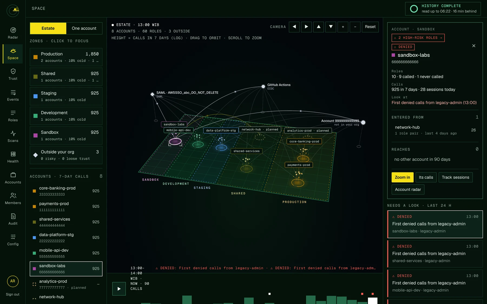

# Changelog

## Unreleased

### Changed
- **Indexes for foreign keys that cascade into big tables** (migration `037_fk_indexes.sql`, built `CONCURRENTLY`): `principal_id` on `activity_daily`, `role_sessions` and `track_sessions`; `role_id` on `role_sessions` and `changes`; `delivery_id` on `alert_hits`. Pruning old callers, removing an account and pruning alert deliveries read whole tables once per deleted row without them: deleting 20 callers at 5M activity rows went from 9.2 s to 80 ms, and a role page's top actions per caller from 46 ms to 2 ms. A test now fails if a big table gets a foreign key without an index.
- **Policy page follows the re-rated defaults.** The control catalogue describes the new built-in severities (evidence gaps, wildcards, idle roles, deleted identities, whole-account trust); new control `perm.not-action`; a credential control set to high weighs 50 (High on its own, like console-no-mfa). An unused administrator role is high through *Administrator access not used in 90 days*, so *Role not used* stops at medium instead of raising it twice. Workspace overrides still win.
- **Built-in rules re-rated** (every rule and its severity is now listed in `docs/rules.md`). High means someone could get access they should not have; a finding that only says use could not be proven is never high.
  - *Could not verify* findings (data events, not logged, checked but not logged, before the window, service used, unmapped events) were rated by the riskiest action involved, so nearly every workload role had a high one. Now low, and medium only for access-changing actions (`src/analyzer/sensitive.js`), writes to every bucket or table, and `iam:PassRole` on every role.
  - *Wildcards* are rated by what they expand to: `iam:*`, `iam:Put*`, `organizations:*` high (were medium); read-only ones such as `ec2:Describe*` low (were medium); service-linked roles low. `Allow` with `NotAction` on every resource is now a finding.
  - *Idle role* is high for an unused role with `*`, identity-plane rights or a trust anyone can use, medium when it can write, low when read-only or service-linked (was always medium). Roles under 14 days old are not idle yet.
  - *Risk score*: a role anyone can assume is High on its own (50, was 30); wildcards count by severity. *Console password without MFA* is High on its own (50, was 30).
  - *Trust map*: the role's own account as `:root` is low unless the role is High risk (was medium); a deleted identity is low (was medium), in Google Cloud too.
  - *Radar*: first denied calls is warn (was high); a new unidentified event name is info (was warn). The scan-failed alert is labelled medium.
  - Open findings take their new severity at the next analysis; no alert is re-sent for them.

### Added
- **Database space per AWS account** (*Accounts*, on each card; *Operations → Database*, with growth over 7 days and the tables it sits in). Every table tied to an account is found from its foreign keys (directly, through roles, or through sessions), so new tables are picked up on their own. Small tables are counted exactly; big ones are split by a `TABLESAMPLE SYSTEM` page sample, with the smallest accounts counted exactly through the key's index (at most 25 accounts and 2 s a table). Each table's measured size is shared out by those counts, so accounts add up to the tables. Estimated hourly with the database sample; the size shown is the average of the last 24 estimates. At 25 million rows (7 GB): about 3 s an hour, 3% of the big tables' pages; median error 3.5%, p90 11% (`bench/account-storage.bench.mjs`). Migration `036_account_storage.sql`.
- **Google Cloud role usage from audit logs (optional, per connection).** Off until turned on in a connection's *Edit* page (*3. Role usage from audit logs*): lookback 1 to 400 days (default 30) and, optionally, Data Access logs. Each project's Admin Activity log is read with the Logging API (`entries.list`) from the free `_Required` bucket, so no log sink is needed: newest first, then back to the lookback one UTC day at a time, then only new entries every catch-up interval. A window's counts and the cursor move commit together, so a worker dying mid-window re-reads it and never counts twice; cursors are leased per project and log, so workers share projects. Reads share a per-connection token bucket in Postgres (*Configuration → Google Cloud role usage*, `GCP_USAGE_READS_PER_MINUTE`, default 50). Only per-day counts of who checked which permission are kept, never the entries. Pages are asked for with the documented `fields` parameter: the caller and permission checks only, else the whole `protoPayload`; if a mask is refused or comes back without those fields the next one is tried, and if none works the read fails and is retried later. Whole entries are never read. Identities get *used*, *never used* and *unconfirmed* (reads that only Data Access logs record) counts, a *Most unused* sort and a *Usage* tab (calls per day, every permission with its status, calls, last use and projects). Each connection shows backfill progress, errors and space per project. Onboarding adds `logging.logEntries.list` (and `logging.privateLogEntries.list` for Data Access), with an `iam roles update` command for existing connections. New `GET /api/gcp/connections/:id/usage`, `GET /api/gcp/principals/:id/usage`; `usage` on connection create and update. Migration `035_gcp_usage.sql`.
- **Database space per Google Cloud project** (*Operations → Database*, and per connection): rows are counted as they are written and turned into bytes with each table's measured size per row, so the split adds up to the tables without scanning them; saved with the hourly database sample (`gcp_usage_projects.bytes_est`). About 84 bytes a day row at 4 million rows; `bench/gcp-usage.bench.mjs` measures it and every query's plan.
- **Policy (Review → Policy, `#/policy`).** Every rule the tool checks is a control in one catalogue: 64 built in, 20 of them written as rules. A built-in control can be given another severity or turned off; the analyser, the IAM user checks, the Trust map and the Google Cloud analysis follow. **Custom controls** are rules about identities (AWS roles and IAM users, Google Cloud principals) or about ways in, in one language: `key operator value` with `=`, `!=`, `>`, `>=`, `<`, `<=`, joined by `AND`, `OR`, `NOT` and brackets, a key usable any number of times; tested as typed, filed as findings that close when they stop matching. AWS rules run as one parameterised, read-only, time-limited SQL query over an index on actions (5 to 70 ms on 2.8 million allowed actions). The policy exports to JSON and imports with a dry run. New Trust map key `fromenv`. API under `/api/controls`. Migration `035_controls.sql` (`control_overrides`, `custom_controls`, `flags.control`, index `role_actions_action`).
- **Third-party access in access reviews.** A review freezes who outside the estate could get into its accounts (from the Trust map) when it is taken: a section on the review, in the printout and as `/api/reviews/:id/third-parties.csv`, signed off with the rest.
- **Home, the page after sign-in (`#/`).** Tells each member what to do first: up to five actions, most urgent first (failed scans; high findings their review team signs off; least-privilege drafts and access reviews waiting for their team; old keys, console without MFA, unidentified calls, medium findings; setup steps), each with why and one button to the page that does it. Only what the member can act on is listed; *Not now* hides an item for that person for 7 days (setup items 30). Beside it: their queue as counts, the changes they have not seen, the estate at a glance and one card per rail group. With no account yet, Home is a six-step setup checklist; while history is read, what needs none of it comes first and findings links open on the accounts that are done. Auditors get the evidence instead (latest signed review, open reviews, audit log). Refreshes every 2 minutes while visible. New `GET /api/home`, `POST|DELETE /api/home/snooze`, `POST /api/home/setup`. The list is built on the server (`src/homeApi.js`).
- **Wall view opens Home**, as the team's version: *Waiting on the team* in large type, the last 24 hours of changes, the estate tiles, a clock; no per-person parts. `GET /api/home?wall=1`.
- **Drafts waiting for approval** (Findings → *Drafts waiting*, `#/findings?state=drafts`): every current draft that passes its safety checks, on an account whose history is read, still waiting for a review team; *Waiting for my team* narrows it. New `GET /api/recommendations?status=draft&mine=1`.
- **"What to do first" digest.** A new alert rule kind (Admin → Alerts → *What to do first*), off until someone adds one: once a day at its own time on chosen weekdays, it posts the list Home shows a review team (or both), with which kinds of item, at most how many, the rule's environments and accounts, and whether to skip the message when nothing is waiting.
- Migration `031_home.sql` (it sorts before `031_trust_review.sql`; both run): `home_snoozes`, `users.home_setup_hidden`, the `todo` trigger and its digest columns on `alert_rules`.
- **Trust map: what is around trust, and what to do about it.** Scans read EKS cluster names, the organisation's accounts and IAM Identity Center assignments where the scanner role may (new read permissions in the generated policy; denied reads are skipped). The organisation's own accounts are shown as yours, not onboarded, with *Add as planned*; Identity Center ways in list who is assigned. Role chaining from a source or an account (*Where it leads next*). *Tighter trust policy…* suggests a new trust policy from what was seen. A *Grid* tab (sources × accounts). Migrations `033_caller_keys.sql` (merges Bitbucket step callers; about 45 s for 90,000 callers) and `034_estate_context.sql`. New dependencies `@aws-sdk/client-eks`, `@aws-sdk/client-sso-admin`, `@aws-sdk/client-identitystore`.
- **Trust map: names, reach, grouping, reports, views.** Outside AWS accounts are named from fwd:cloudsec's list of known AWS accounts (bundled, Apache-2.0, `THIRD_PARTY_NOTICES.md`) and the workspace can name any source with an owner, purpose and review date. Ways in, lines and sources show administrator roles reached and accounts administered, first seen, and sort by reach. *Group the same trust* (`/api/trust/groups`) decides or expects a pattern across every account at once. Third-party access report (`/api/trust/third-parties.csv`). Saved views (`/api/views`, own or shared), in the Views menu and the search box, which also finds trust sources. The map exports as a PNG. Trust findings link to the Trust map. Migration `032_trust_names_views.sql`.
- **Trust review.** The Trust map's findings are filed in the Findings inbox (category *Trust policy*, high and medium) by the worker, from the same rules the map uses, and resolved when the trust policy is fixed; the analyzer's own trust-wildcard findings are retired. Decisions show on each way in and can be made from its row. **Expected trust** (*Mark as expected…* on a source, a line or a way in): roles, accounts and the findings it is accepted with, a reason and a review date; covered ways in leave *Needs attention*, the map's colour and the inbox until a new finding or the review date. **What changed:** ways in added or weakened (a guard taken off) are marked, filterable (`new:7`, `new:weakened`), counted in a *New · 7 days* tile and sent to the change feed and alerts (`new-trust`, `trust-weakened`). New keys `attention:`, `expected:`, `decided:`, `new:`. Migration `031_trust_review.sql`.
- **Trust map, reorganised.** One filter bar (search, menus for accounts, environment, source, finding and use, removable pills, one *Clear all*), tiles that filter, and three tabs: *Map*, *Sources* (every source, sortable) and *Ways in* (paged by the server, sortable, rows open for conditions, findings, callers and actions). The panel opens on a pick (a drawer under 1300 px); Back and Esc close it. The map starts folded by kind of source and environment, draws only what needs attention unless asked, counts hubs and EKS clusters instead of drawing them, focuses on a pick, is laid out in real pixels so text stays readable, and is one tab stop with arrow keys. A hover card replaces the browser's tooltips; the key opens on the first visit.
- **Query language:** a comma means either (`finding:public,account-root`); `source:` takes provider kinds (`github`, `bitbucket`, `eks`, `cognito`, `identity-center`…); `used:iam`; unknown keys and findings are named, with a suggestion.
- **Exports:** ways in (`/api/trust.csv`, with the pick) and sources (`/api/trust/sources.csv`), through the shared CSV helper: dated names, cells safe for spreadsheets, environment, role risk, finding text, sessions, callers and last seen columns, and the latest callers instead of every one.
- **Responses are compressed** (gzip), for every page.
- **Radar replay.** A slider over the last 90 days and a Play button show the estate as it was, from the daily snapshots (`/radar/estate?asof=N`). Role counts and risk stay today's; accounts not yet read then are left off.
- **Space, any of the last 30 days.** A day picker beside Play shows that day's 24 hours (`?day=N`); the 7-day heights stay current.
- **Find on the map.** Space: type an account, role or outside identity and the view flies to it (also F, double-click, or the go-to button). Radar: *Find an account* filters the list; Enter picks the first.
- **Wall view** on both pages: the scene alone, full screen, refreshing itself every 5 minutes; Space plays the day. Esc leaves it.
- **Alert rules by account.** A rule can name accounts as well as environments (the shared account picker); with both, an account must match both. Migration 030.
- **Old alert messages are removed.** Sent and failed messages go after 90 days, an hour at a time in batches; set it on the Alerts page (*Keep for*) or with `ALERT_KEEP_DAYS`. A match now records when it was queued (`alert_hits.queued_at`), so removing its message never posts it again.
- **Trigram indexes for search.** `Ctrl K` matches `%text%`, which a normal index cannot serve. Migration 030 adds `pg_trgm` (a trusted extension; if the database user cannot add it, search works as before) and GIN trigram indexes on role names and ARNs, access key IDs and Google Cloud principals.
- **History tab** on every role and IAM user: what changed on it, newest first, filtered by kind. Inventory now compares each identity with what is stored and records policies attached, detached or edited (before and after, with a line diff on the page; an AWS managed policy shows when AWS publishes a version), trust policy and permission boundary changes, keys deactivated or activated, MFA devices and console passwords added or removed, identities deleted or back. Analysis records risk level changes once an account's history is complete. Keys created and deleted, Radar's changes and every decision and approval (from the audit log) are merged in. New `GET /api/roles/:id/history` and `GET /api/roles/:id/history/:eventId`.
- **Access reviews (Reviews in the rail).** A frozen snapshot of the roles and IAM users in chosen accounts for a period: risk, permissions, calls and callers in the period, keys and console sign-in, every finding with its decision. Signed off once by each review team listed; a signed-off review cannot be removed. Identities CSV, decisions CSV, and a print layout to save as PDF. Audited as `review.create`, `review.signoff`, `review.delete`.
- **CSV downloads of the Roles and IAM users lists** (`/api/roles.csv`, `/api/iam-users.csv`), with the list's filters and the member's account scope. Cells starting with `= + - @` are escaped so spreadsheets do not run them.
- **Alerts (Admin → Alerts).** Rules that post to Slack or a webhook: a new finding at or above a severity, a Radar change (new caller, permissions gained, first denied calls… by kind), an access key past its rotation age, a console password without MFA, a failed scan. Each rule can be limited to environments and sends at once (checked every minute) or as a daily digest (`ALERT_DIGEST_AT`, 09:00 local). Matches found together go out as one message. Events count from when the rule is created or switched on (no backlog); conditions post what is true now once. One retry two minutes after a failure; a log of every message on the page. Destination URLs are stored encrypted and never returned; https only in production, no loopback or metadata addresses, no redirects followed. Changes are audited (`alert.*`). New tables `alert_destinations`, `alert_rules`, `alert_deliveries`, `alert_hits` (migration 027); the worker runs `alertsTick` under an advisory lock.
- **Risk thresholds are settings.** The access key rotation age and the unused age (both 90 days) are on Admin → Configuration and in `KEY_ROTATE_DAYS` / `KEY_UNUSED_DAYS`, instead of fixed in code. They drive IAM user findings and risk, the IAM users list, Google Cloud key findings and the key-age alert.
- **Search everything (`Ctrl K` / `⌘ K`).** From any page, or the *Search* button in the top bar: type a role, IAM user, access key ID, account name or ID, Google Cloud identity or page name, move with the arrows and press Enter. An access key opens its user's *Credentials* tab; an account opens its roles; *Events for "…"* searches every call. New `GET /api/search?q=`: up to 5 of each kind, exact names first, only in the accounts the member can see (no Google Cloud for members limited to some AWS accounts).
- **Findings inbox (Review → Findings).** Every open finding on the roles and IAM users a member can see, in one list: severity tiles that filter, type, account, roles or IAM users, *Needs a decision / Decided / All*, *My team's* (roles your review team signs off, and those both teams do) and search, all kept in the address. The selected finding's evidence and decision buttons sit beside the list, so deciding never leaves it. Tick several and decide them at once with one note, or clear their decisions. Keys: `j`/`k` move, `x` selects, `1`–`3` decide, `Esc` unselects, `/` searches. The rail shows how many findings wait for a decision. New `GET /api/findings`, `POST /api/findings/decisions` and `POST /api/findings/decisions/clear`: a bulk decision is all or nothing (every finding must be open, visible to the member and of a kind that takes the decision) and is audited once per finding as `flag.decide` with `bulk: true`. `GET /api/status` also returns `findings`, the waiting count.
- **IAM user monitoring.** A new *IAM users* page lists every user with each access key (ID, status, age, last use, rotate or deactivate badges), console password and MFA, groups and activity, with filters and sorting; a page per user adds CloudTrail activity per key, who used it in 30 days, roles it assumed and its policies (including its groups'). Users get the same permission analysis as roles, plus findings for old, unused or duplicate keys and console access without MFA.
- **Radar and Space: Show All | Roles | IAM users.** Users appear on both (squares in Space, their own sector on the account radar).
- The scanner policy now includes the IAM user, access key, MFA, login profile and group reads. Without them, users are skipped with a warning and stored users are kept.
- **Google Cloud (permissions only).** Connect an organization, folder or project with workload identity federation from the app's own AWS role or a service account key; generated `gcloud` commands, a test before saving, daily scans. Every identity's roles inherited down the hierarchy, its combined permissions, who can become each service account (keys, impersonation, actAs, key creation, GKE, federation) and findings (basic roles, IAM admin, mass impersonation, old keys, default service accounts with Editor, outside users, public grants, pools with no condition). Audit logs are not read yet.
- **Roles: AWS | Google Cloud tabs** on one page, and a page per Google identity with what it can do, where it comes from, who it can become and its paths to AWS.
- **Space: two fields.** AWS and Google Cloud on two planes with the same environment zones, and arcs where one cloud can sign in to the other (red when any AWS role can). Projects and cross-cloud paths have their own panels; AWS accounts list their Google Cloud paths.
- **Across clouds everywhere:** an AWS role's page lists where it reaches in Google Cloud and which Google service accounts it trusts; the Trust map names the Google service account a role trusts.
- **Password reset by an owner.** Members → *Reset password* makes a single-use link (24 hours, hash-only storage, token after the `#`) for the member to choose a new password. Using it signs them out everywhere and can reset their two-factor too. Owners only; audited as `member.password_reset_link` and `auth.password_reset`.
- **Single sign-on on the Configuration page.** Owners set OIDC there instead of only by environment variables, with a JumpCloud preset (issuer per region, scopes, group claim), the redirect and login URLs to copy, a *Check issuer* test and a warning when no group is mapped to a role. The client secret is stored encrypted and never returned. The sign-in button says which provider it is.
- **Light theme.** A sun/moon button in the top bar switches between the dark theme and a light one: the same design on pale mint paper with deep green ink, with banana kept for buttons and darkened to gold for text. The choice is kept per browser. Drawings (Space, Radar, Track, the sign-in radar) are mapped colour by colour, so every page follows the theme.
- **IAM Identity Center as one source.** Every account's `AWSSSO_<id>_DO_NOT_DELETE` SAML provider is matched to its Identity Center instance by the issuer in its metadata, and the Trust map and Space draw each instance once, with the account it is managed from.
- **Warnings for a second Identity Center.** An account that trusts more than one instance, or an instance other than the one most of your accounts use, is a high finding (`finding:idc-multiple`, `finding:idc-other`). Either can mean an account instance turned on inside a member account, or another organisation's.
- **Space: In, Out or Both.** A toggle shows only who can get into an account (outside identities, your other accounts, the scanner) or only where it can go. Paths between your accounts now include what trust policies allow, not only what was used: dashed when allowed but unused, red when the trust is risky.
- **Environments are yours to edit.** Add, rename, recolour, reorder or remove environments on the Configuration page. Removing one that accounts use asks where to move them.
- **Space: what you pick stands out.** Picking an account, role, service, outside identity or path keeps it and everything connected to it lit, and fades the rest. The page still opens with the whole scene lit.

### Fixed
- Bitbucket Pipelines callers were recorded one per pipeline step (the step is in the subject); they are now one per repository and environment, and existing ones are merged (96,470 callers became 7,302 on the test estate, sessions unchanged). Callers not seen for `CALLER_KEEP_DAYS` (default 400) are removed.
- On a phone the status bar was about 200 px wider than the screen on every page; it now shows icons only under 600 px.
- A menu closed by itself when the page was still scrolling (or focusing its first item scrolled a container); it now follows its button while the button is on screen.
- **Trust map counted sign-ins once per statement.** A role with two statements for one provider, or one naming two principals of the same account, doubled its sessions on the line and the source. Each caller now counts once per role.
- **Trust map: "used" was matched on the provider's host.** Every EKS cluster in a region, every Bitbucket workspace and every repository behind one GitHub provider vouched for each other's statements. A sign-in now counts only for the statement whose provider path and `:sub` conditions it matches.
- **Trust map: Bitbucket's repository pin (`{repository}:*`) was high.** The step is part of Bitbucket's subject, so the wildcard is how a role is pinned to a repository: now low, and nothing when the deployment environment is pinned too.
- **Trust map: Cognito identity pools were judged by a subject they don't use.** They are now checked for the pool (`aud`, high without it), guests (`amr` unauthenticated, medium) and a missing `amr` (low).
- **Trust map: a break-glass role trusting its own account with MFA required** was medium like one without; it is low.
- **Trust map: a chip could break the query** (a quoted value was split on its spaces); filters are now kept as terms and written from them.
- **Session replay did not light the calls as it played.** A name clash in the Track view (since the shared colour helper moved to `lib.js`) stopped the replay with an error.
- **Google Cloud scans failed on any project with GKE.** The scanner asked the GKE workload identity pool (`<project>.svc.id.goog`) for its providers, which Google refuses with a 400, and the whole scan stopped. Google-managed pools are now skipped, and a pool that cannot list its providers is skipped instead of failing the scan.

### Changed
- **Radar moved to `#/radar`.** Old links (`#/?view=account…`, `#/?feed=30`, `#/?who=users`, …) open Radar at the new address. The rail has *Home* at the top; the logo goes Home. Alert links to an account's radar use the new address.
- **The Trust map answers in milliseconds.** Every request used to read every trust policy and every caller and send up to 15 MB; the ways in are now worked out once, kept, and rebuilt only when the data behind them changes. On a 100-account, 5,600-role test estate: the page's first answer from 0.5 s and 15.4 MB to 0.07 s and 41 KB on the wire, first draw from 1.5 s to 0.12 s, a role page's *Who can get in* from 0.3 s to 0.03 s, a pick on the map from about 120 ms to 36 ms. `GET /api/trust` no longer carries the ways in (`GET /api/trust/ways` does), and the map's lines carry counts instead of their roles.
- **The Trust map is the one full list of who can get in.** Space's *Ways in to check first*, *Who can get in · from outside your org* and the Google Cloud lists now show their top five and link to the Trust map filtered to that account (or to Google Cloud's *Reachable from AWS*), instead of growing to the full list. A role's Overview gets a *Who can get in* card: the worst five ways in from its trust policy, used or not, and *See all in Trust map*, filtered with the new exact `roleid:` key.
- **Radar and the bell show one change feed.** The bell used to count Space's last 24 hours ("N TO LOOK AT") and, on Space, showed Space's own list; Radar showed 7 days. Now both read `GET /changes`: the bell shows what you have not seen ("N NEW"), with *Mark all as seen* and a link to Radar; Radar shows the same rows for a range of 24 hours, 7, 30 or 90 days (`?feed=`), new ones marked. Picking a change opens its role (its Activity tab for a new caller, History otherwise), or its account on Radar; on Space it is selected in the scene. What is new is tracked by change id per person (`users.changes_seen_id`, migration 029), so a change found late in older history still counts as new. `GET /space/flags` is removed.
- **Times are no longer fixed to WIB.** The workspace's zone is set on Admin → Configuration (*Time zone*, or `DISPLAY_TZ`; defaults to `SCAN_TZ`) and sent with the session. Each person can show times in their own browser's zone instead, from the menu on their avatar; the choice is kept in that browser. Labels follow the zone (WIB, WITA, WIT, or the browser's short name such as GMT+8). Scheduling (daily scan, alert digests) still uses `SCAN_TZ`.
- **Accounts page is a table.** One row per account with environment, status, how much history is read, roles and last scan. *Scan now* (or *Verify connection* when it is not connected) and *Edit* are on the row; Radar, Trust map, Event history, Unidentified calls, Identities and Remove are in its *More* menu. Clicking a row opens what the card used to show (why it cannot be reached, history per region, how it is read, data event sources); the open row is kept in the address (`?open=`). With more than six accounts the table gets a search and a status filter.
- **One identity page.** A role, an IAM user and a Google Cloud identity open on the same page, `#/identities/<id>`, with tabs: *Overview*, *Activity*, *Permissions*, *Credentials*, *Policies and trust* and *Findings* (tabs that do not apply are left out). The Sector scan is the top of *Permissions* and filters the action list when a sector is clicked; a role's sessions are listed on *Activity* and replay in a window; an IAM user's keys and console sign-in are its *Credentials* tab instead of a second page. The header has one primary action, *Recommend least-privilege policy*. The tab is kept in the address.
- **Identities in the rail.** *Roles* and *IAM users* are one item, *Identities*, with a *Roles | IAM users | Google Cloud* switch at the top of the list. Old addresses (`#/roles`, `#/roles/<id>`, `#/roles/<id>/scan`, `#/roles/<id>/recommendation`, `#/users`, `#/users/<id>`, `#/gcp/principals/<id>`, `#/roles?cloud=gcp`) still open, with their filters.
- **Deciding on a role's Findings tab updates that finding in place** instead of reloading the whole role page, and the tab says how many still wait.
- **A grouped left rail.** The 12 flat items are now three groups: *Watch* (Radar, Space, Trust), *Investigate* (Events, Roles, IAM users) and *Admin* (Accounts, Operations, Admin). Old addresses (`#/scans`, `#/workers`, `#/members`, `#/audit`, `#/settings`, `#/accounts/<id>/unidentified`) still open and are swapped for the new ones.
- **Operations** is one page with three tabs: *Scans*, *Workers* and *Database*. Health is split into the last two, and the workers table is no longer repeated on Scans.
- **Admin** is one page with *Members*, *Audit log* and *Configuration* tabs; a tab shows only to people who may use it. Single sign-on group mappings moved from Members to Configuration → Single sign-on, next to the rest of the SSO setup.
- **Unidentified calls for the whole estate.** `#/unidentified` lists every account's unidentified event names, with an account filter; the top-bar badge opens it instead of the first account still being read. New `GET /api/coverage` returns the same data as `/api/accounts/:id/coverage` across the accounts a member can see.
- **Accounts: AWS | Google Cloud tabs.** Google Cloud connections moved from the bottom of the Accounts page to their own tab there, where they are connected and edited. The Roles page's Google Cloud tab links to it instead of offering its own *Connect* button.
- **Space, easier to read.** The right-hand panel now leads with one sentence, the key numbers, then who can get in (from outside your org and from your other accounts, separately) and where it goes. With nothing picked it shows an overview and what to check first. The legend is folded away.
- **Windows instead of leaving the page.** Anything in Space that used to navigate away (calls, a role, the trust map, sessions) opens in a window over Space, marked with a window icon; it is loaded when opened and dropped when closed. Entries under "who can get in" and "where it goes" open the sessions or trust behind them.
- **A bell in the top bar** lists what needs a look in the last 24 hours, on every page.
- **Move the view** in Space: Shift+drag, right-drag, a sideways swipe, the arrow keys or the Move buttons.
- **Events and Space rebuilt for large estates.** Two small tables are written as calls arrive: how many calls of each kind every role made in each hour, and which sessions were active. A search now reads them first, so it skips hours with no match and reads only the sessions that can have one; a search with no match anywhere answers at once. On 20 million stored calls a rare search (`ssm:` denied over 7 days) went from 51 s to 0.5 s, and the first page from seconds to about 150 ms.
- Calls stored before the upgrade are counted in the background, newest day first; Events says how far back it has got. Until then older hours are searched the previous way.
- Space and the first page of Events are remembered for a few seconds in the API and refreshed in the background while someone is looking; the browser remembers both Space views, and fetches an account as soon as you pick it, so zooming in does not wait.
- A search gives up after about 12 seconds and returns what it has, then carries on as you scroll, instead of holding a database connection for a minute.
- Optional `DATABASE_READ_URL` sends Events and Space reads to a replica.
- The scanner policy now includes `iam:ListSAMLProviders` and `iam:GetSAMLProvider` (metadata only). Existing scanner roles keep working without them; until they are added, Identity Center instances are grouped as one and marked "instance not read yet".
- Events and Space are much faster on large estates (tens of millions of calls); two indexes are built without blocking writes on first start.

## 0.1.0 · 2026-11-09

The first release of **Curious Monkey**: see what every IAM role in every AWS account really uses, who can get into it, and cut it down to least privilege with evidence. Self-hosted and read-only.



### What's in it

- **Radar**: every account (or every role in one account) at a glance: share of permissions never used, excess, 7- and 30-day trends, and pings for changes that matter.
- **Space**: the estate on a 3D plane, replayed hour by hour over the last 24 hours, with account-to-account paths and outside identities. Zoom into one account to see roles grouped by the service they call.
- **Trust map**: who can get into your AWS (outside accounts and vendors, GitHub Actions, Bitbucket, EKS, SAML, `*`) and your accounts trusting each other, coloured by risk, with findings such as whole-account trust, missing `sts:ExternalId`, or OIDC without a `sub` condition.
- **Roles**: granted vs. used vs. unverifiable permissions for every role, why it is high risk, who assumed it (with or without MFA), and the trust conditions they met.
- **Least-privilege recommendations**: drafted from the evidence (rules, or Amazon Bedrock if you enable it), checked, and approved by the security teams.
- **Track**: replay one session call by call, including role chaining across accounts. Also available from Space.
- **Event history**: search every call your roles made by role, user, IP, action, resource or error; export to CSV.
- **Sector scan**: one role cut into services and access levels.
- **Scanning**: Event History or an S3 trail (including organization trails), read incrementally with checkpoints, a separate worker that resumes after a crash, a daily scan plus catch-up reads every 30 minutes, planned accounts before onboarding.
- **Health**: database and worker health, with what to change.
- **Access**: owner, admin, reviewer, account owner and auditor roles; two-factor for anyone who can approve; SSO (OIDC); an audit log.

### Try it

```sh
git clone https://github.com/danuesarf/curiousmonkey && cd curiousmonkey
cp .env.example .env
perl -pi -e 's/^AWS_MODE=.*/AWS_MODE=demo/; s/^(POSTGRES_PASSWORD|SESSION_SECRET|DATA_ENCRYPTION_KEY)=$/$1 . "=" . `openssl rand -hex 32`/e' .env
docker compose up -d --build
docker compose exec app node src/cli.js demo
```

Open http://localhost:8080 and sign up; the first person becomes the owner. For real AWS accounts, leave `AWS_MODE=aws` and follow **Connecting an account** in the README. Kubernetes manifests are in `deploy/k8s`.

### Security

Every push is checked by tests, npm audit, Trivy (dependencies, configuration and the container image), Semgrep, Gitleaks and Checkov. The image runs as a non-root user without npm.

### Known limits

- MIT licensed.
- This is a 0.x release: the database schema may still change (migrations run automatically on start).
- Calls are kept one by one for `SESSION_RETENTION_DAYS` (default 30); counts per day are kept for the whole lookback.
- Event History reaches back 90 days; read from an S3 trail for longer.
