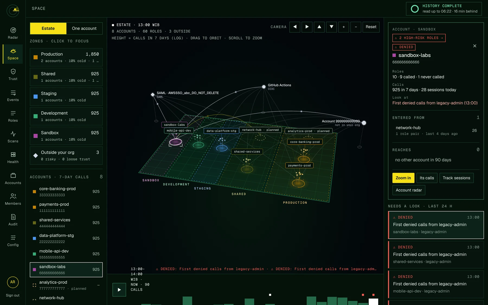
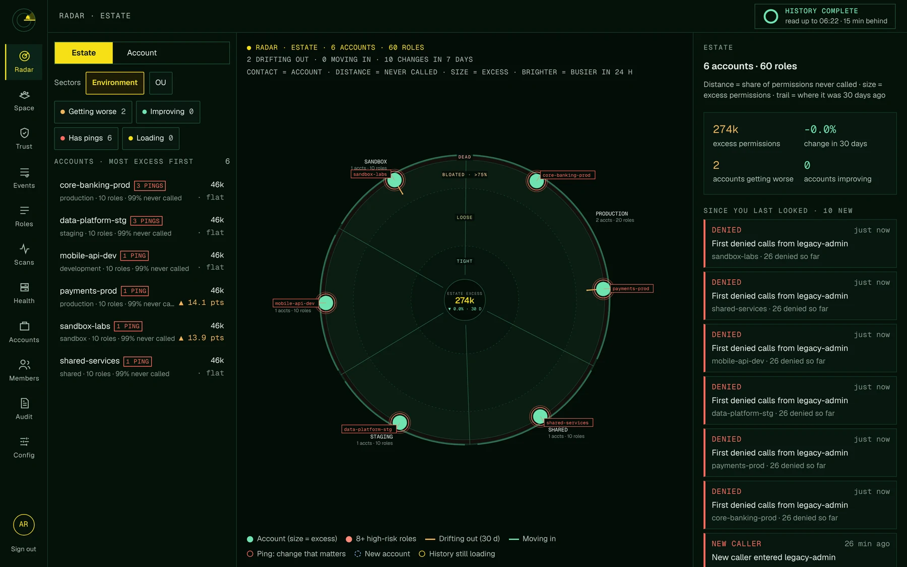
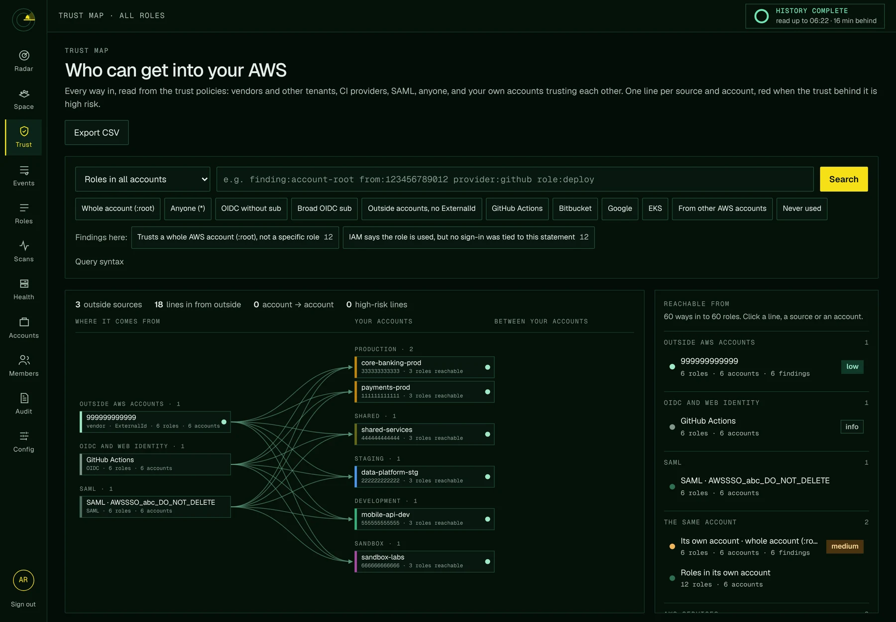
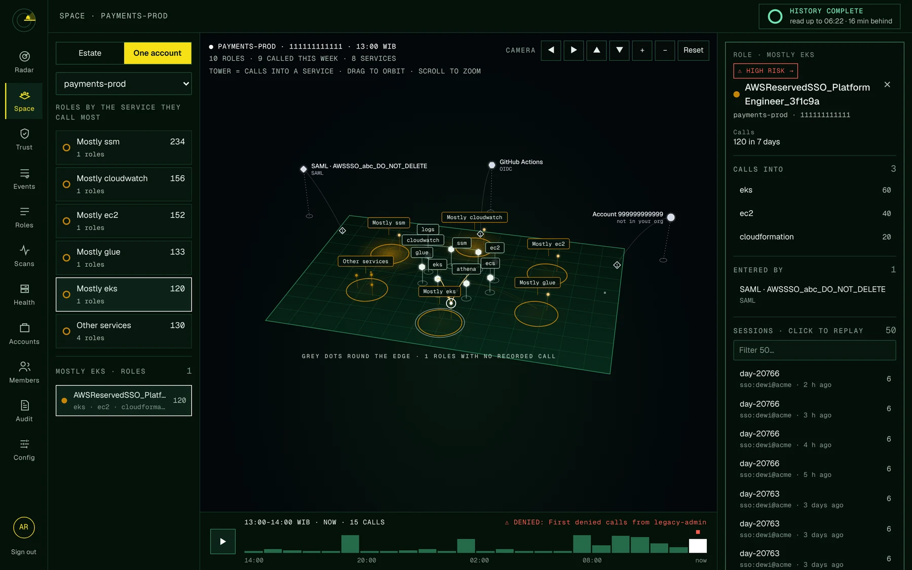
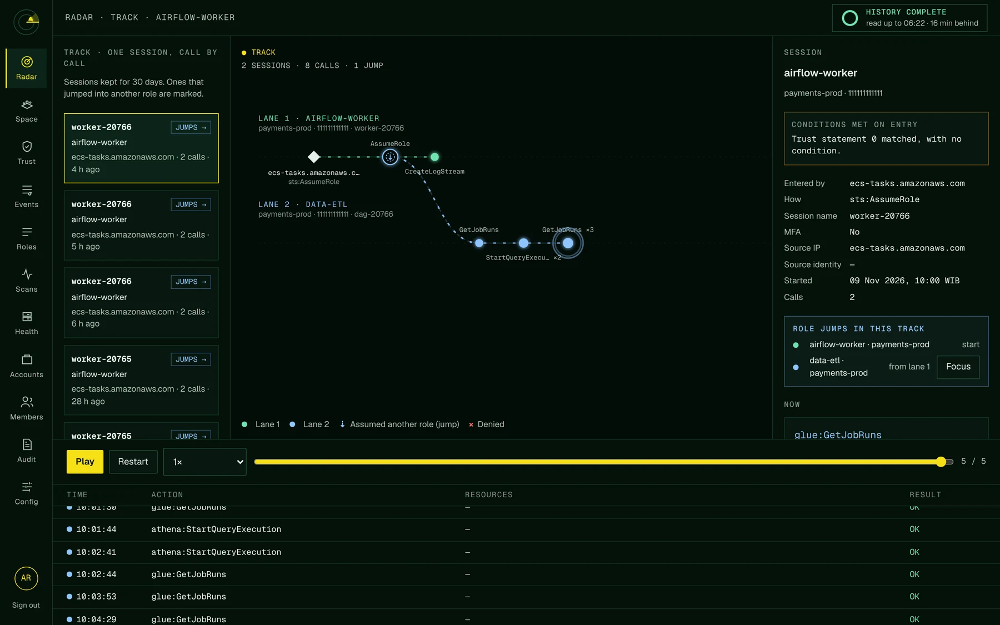
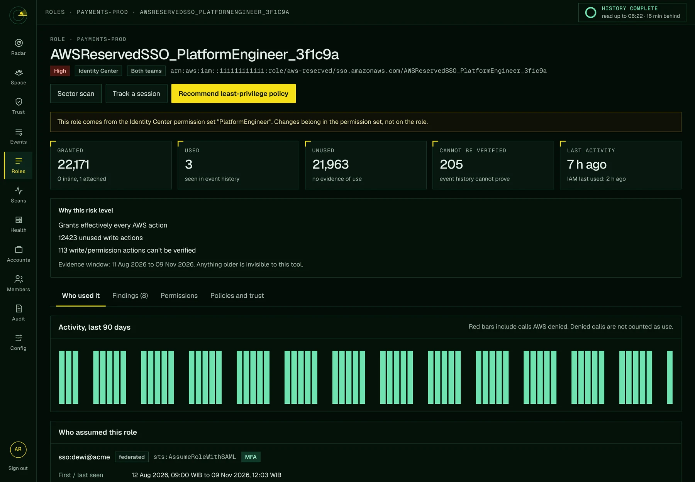
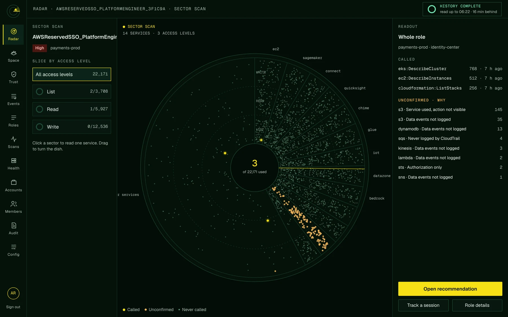
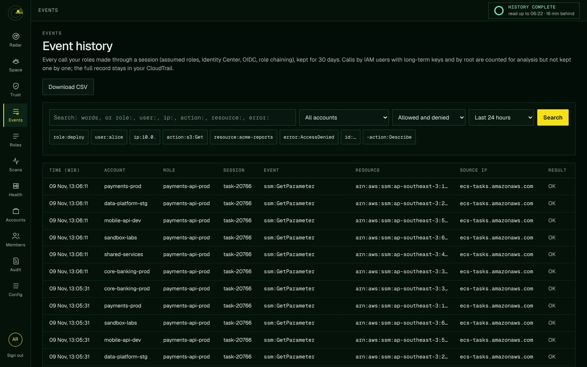
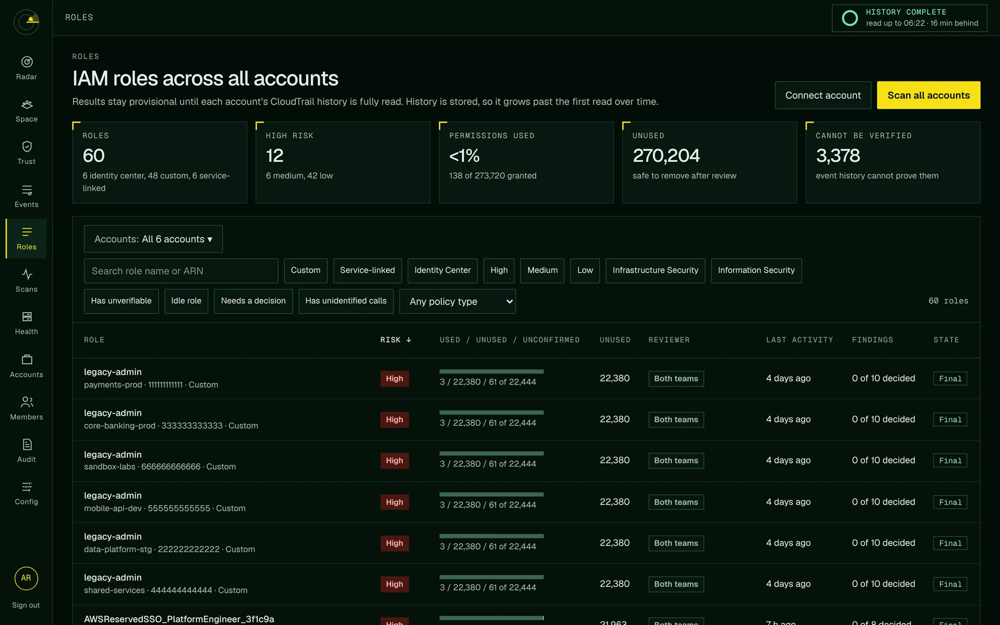
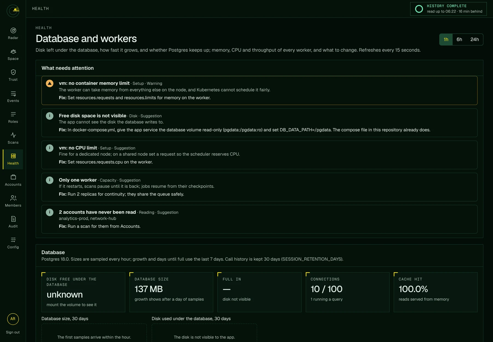

# Curious Monkey

> The monkey only needs a banana. Don't give it a bazooka.

**See what every IAM role in every AWS account really uses, who can get into it, and cut it down to least privilege with evidence.** Self-hosted, read-only, and explicitly denied access to your data.



- **Who used each role, and how they got in.** Every session from CloudTrail: SSO users, CI pipelines, other accounts, AWS services, with the trust-policy conditions they met on the way in.
- **What was really used.** Permissions granted vs. permissions called, per role, over up to 90 days of history (longer from an S3 trail). Anything event history cannot prove is flagged, not silently dropped.
- **Who can get in from outside.** A trust map of every vendor, tenant, CI provider and SAML/OIDC identity that can assume your roles, with the risky ones in red.
- **A least-privilege policy you can trust.** Drafted from the evidence, checked, and approved by your security teams before anyone applies it.
- **Specific trust instead of `:root`.** A role that trusts a whole account gets a draft trust policy naming only the identities that actually came in, checked and approved the same way.
- **Watch it happen.** Replay any session call by call, follow role chaining across accounts, search every call in Event history, and get pinged when something changes.

**Try it in a minute, no AWS account needed:**

```sh
git clone https://github.com/danuesarf/curiousmonkey && cd curiousmonkey
cp .env.example .env
# demo mode, and fresh random secrets for the database, sessions and stored keys
perl -pi -e 's/^AWS_MODE=.*/AWS_MODE=demo/; s/^(POSTGRES_PASSWORD|SESSION_SECRET|DATA_ENCRYPTION_KEY)=$/$1 . "=" . `openssl rand -hex 32`/e' .env
docker compose up -d --build
docker compose exec app node src/cli.js demo     # adds fake accounts and scans them
```

Open http://localhost:8080 and sign up: the first person becomes the owner, and is asked to set up an authenticator app (two-factor is required for anyone who can approve changes).

## A look around

<table>
<tr>
<td width="50%"><a href="docs/screenshots/radar.webp"></a><br><b>Radar.</b> Every account at a glance: distance is how much of its permissions is never used, size is excess, trails show whether it is getting better or worse, pings flag changes that matter.</td>
<td width="50%"><a href="docs/screenshots/trust-map.webp"></a><br><b>Trust map.</b> Who can get into your AWS: outside accounts, vendors, GitHub Actions, Bitbucket, SAML, anyone, and your accounts trusting each other. Red when the trust behind a line is high risk.</td>
</tr>
<tr>
<td><a href="docs/screenshots/space-account.webp"></a><br><b>Space.</b> One account in 3D: roles grouped by the service they call, towers for the services, outside identities at the edge. Click anything for its sessions and replay them.</td>
<td><a href="docs/screenshots/track.webp"></a><br><b>Track.</b> One session, call by call, with every role it jumped into on its own lane, and the conditions it met on entry.</td>
</tr>
<tr>
<td><a href="docs/screenshots/role.webp"></a><br><b>Every role.</b> Granted vs. used vs. unverifiable, why it is high risk, who assumed it with MFA or not, and a one-click least-privilege recommendation.</td>
<td><a href="docs/screenshots/sector-scan.webp"></a><br><b>Sector scan.</b> One role cut into services and access levels: lit dots were called, amber ones cannot be proven, dim ones were never used.</td>
</tr>
<tr>
<td><a href="docs/screenshots/events.webp"></a><br><b>Event history.</b> Search every call your roles made by role, user, IP, action, resource or error, and export it.</td>
<td><a href="docs/screenshots/roles.webp"></a><br><b>Roles.</b> All roles across all accounts, filtered by risk, kind, reviewer team and findings, with a picker that works for hundreds of accounts.</td>
</tr>
<tr>
<td colspan="2"><a href="docs/screenshots/health.webp"></a><br><b>Health.</b> The database and the scanner workers: disk left, growth, memory and what to change.</td>
</tr>
</table>

<sub>Screenshots are of the built-in demo mode: the accounts and identities are made up.</sub>

## Run it

Needs Docker. The scanner runs in its **own container**, so a heavy scan never slows the portal or API.

```sh
cp .env.example .env            # set POSTGRES_PASSWORD, SESSION_SECRET, DATA_ENCRYPTION_KEY (openssl rand -base64 48)
docker compose up --build       # postgres, app (UI + API), worker
```

Open http://localhost:8080 (change `HOST_PORT` in `.env` if the port is taken) and sign up. **The first person to sign up becomes the owner.** After that, sign-up is by invite link only.

Try it without AWS credentials: set `AWS_MODE=demo` in `.env`, then `docker compose exec app node src/cli.js demo`. This adds two fake accounts and queues their first scans.

Kubernetes: `kubectl apply -k deploy/k8s` (copy `secret.example.yaml` to a real secret first). The API and the worker are separate Deployments; scale workers with `replicas`.

## How the scanner works

- Scans are jobs in a Postgres queue (`FOR UPDATE SKIP LOCKED`). Steps: inventory, events (one job per region), Access Advisor, analyze.
- A job holds a 90 s lease, renewed by heartbeat. If a worker dies, the reaper requeues the job and another worker continues from the saved checkpoint. Failures retry with backoff (30 s doubling to 30 min, 5 attempts). Permission errors fail at once and are not retried.
- Event history is read in 6-hour slices. Each slice commits its aggregates and checkpoint together, so a restart never re-reads saved history or double counts. A daily scan reads only what is new.
- CloudTrail Event History keeps 90 days. If the worker is down longer than that, the gap is shown on the account page.
- Monitor everything under **Operations** (Scans: queue, per-job progress, logs, retry, cancel). Prometheus metrics are on the worker at `:8081/metrics`.

## Connecting an account

The **Connect an AWS account** wizard has four steps. Nothing is saved until the last one.

1. **Account**: name, account ID, environment, regions.
2. **CloudTrail source**:
   - **Event History** works out of the box. It covers at most 90 days, holds management events only, and is slow, because AWS allows 2 requests a second (about 100 events a second per region).
   - **S3 trail** reads the trail's log files. It has no request limit, so it usually takes minutes. History goes as far back as the files exist (up to 2 years here), and it includes data events if the trail logs them.
   - The wizard estimates the first scan's duration. Scan activity shows a live ETA while it runs.
3. **Access**:
   - **Assume a scanner role** (recommended). The base identity is either the worker's own credentials (instance, task or pod role, or keys in `.env`) or an access key stored encrypted on the account.
   - **IAM user access key**: the keys of a dedicated read-only user, used directly.
4. **Deploy and connect**: apply the Terraform or CloudFormation template, then connect. You land on Scan activity.

Edit an account at any time. Switching source keeps the stored history. Widening the lookback backfills only the older days. The worker logs which AWS identity it runs as at startup, and the wizard shows it.

## Home

After sign-in the portal opens on **Home** (`#/`). It tells each member what to do first: up to five actions, most urgent first, each with why and one button to the page that does it. Failed scans come first; then high findings on roles the member's review team signs off, least-privilege drafts and access reviews waiting for that team; then old access keys, console passwords without MFA, unidentified calls and medium findings; then setup steps not done yet (members and review teams, alerts, single sign-on, a periodic access review). Only what the member can act on is listed, and *Not now* hides an item for them for a week. Beside the list: their queue as counts, the changes they have not seen, the estate at a glance, and one card per part of the rail saying what question it answers.

With no account connected yet, Home is a six-step setup checklist. While history is still read, what needs none of it comes first (the Trust map, inviting the team, alerts). Auditors see where the evidence is instead. **Wall view** (`#/?wall=1`) shows the team's version, large, refreshing itself every 5 minutes.

## The radar

**Radar** (`#/radar`) has two views:

- **Estate:** each contact is an AWS account. Distance from the centre is its share of permissions never called; size is its excess permissions (granted minus used). A trail shows where it was 7 and 30 days ago: amber when drifting outward (getting worse), green when moving inward. Brightness is activity: the busier the account in the last 24 hours, the brighter its contact. Pings mark changes that matter. Sectors are environments, or the OU / group you set on each account.
- **Account:** the same for one account's roles, sectored by role kind.

**What changed** comes from two tables. After each final analysis of a fully read account, every role gets a daily snapshot (`role_snapshots`); trails and trends compare against them, so they appear after 7 and 30 days. The same step records changes (`changes`): permissions grew (or reached admin level), trimmed, first denied calls, went 90 days without calls, new roles, new unidentified event names. A caller seen entering a role for the first time is recorded while events are read. Nothing is recorded during an account's first read, when everything would look new. There is one change feed. Radar lists it for a range (`?feed=1|7|30|90` days, 7 by default) and marks what is new to you; the bell in the top bar shows only what is new to you, with *Mark all as seen*. "New" means recorded after you last looked (by change id, since a new caller can be found in older history), and opening the estate on Radar counts as looking. In demo mode, `node src/cli.js demo-history` invents 35 days of snapshots and a few changes so this can be seen at once.

- **Sector scan** (the top of an identity's *Permissions* tab) cuts one role into rings (access level) and sectors (service). Lit dots were called, amber dots are unconfirmed, dim dots were never called.
- **Track** replays one role session call by call. Each session is a lane. When a session assumes another role (role chaining), the call is drawn as a jump into a new lane for the new session, linked by access key. Chains across connected accounts are linked too. Sessions in accounts you can't see are counted, not shown. Session replays are kept for `SESSION_RETENTION_DAYS` (default 30). Space opens the same replay over the map: a role's sessions are listed in its sidebar (click one to replay it), and **Track sessions** on a role, an account or an account-to-account path lists theirs.

### Results while history is still loading

The radar and role pages show data as soon as the first slices are read. Until an account's history is fully read, its results are marked **provisional**: used counts are "at least", never-called counts are "at most". The status bar shows how much is read and the time left. A provisional analysis runs every `PROVISIONAL_EVERY_SECONDS` (default 300). **Approval is blocked until history is complete.**

## Keeping up between scans

Two separate questions, two separate answers in the status bar:

- **History** (the dial): has each account's whole lookback been read? It fills once, then says *History complete* and stays that way.
- **Freshness** (the line under it): how current is the data? *read up to 14:05 · 12 min behind*, for the least current account. Green while it is within two catch-up intervals, amber after that, red after a day and a half. Each account's own freshness is on the Accounts page.

The daily scan (`SCAN_AT`, 01:00 `SCAN_TZ`) reads everything: roles, policies, Access Advisor, new CloudTrail events. Between daily scans, **catch-up reads** run every `TAIL_EVERY_MINUTES` (default 30; Configuration › *Read new events every*; 0 turns them off). A catch-up read is an events job per region plus an analysis, for accounts whose history is complete and that have no scan in flight. It reads only what arrived since the last read, so a quiet account costs one CloudTrail call per region, and the analysis is skipped when nothing new arrived. Inventory, Access Advisor and the daily change snapshot wait for the daily scan. Catch-up reads stay out of the Scans list unless one fails; finished ones are deleted after two days.

CloudTrail delivers events 5 to 15 minutes late and reads hold back `SCAN_DELIVERY_LAG_MINUTES` (15), so data is at best about 15 minutes behind. An interval shorter than about 5 minutes only adds AWS calls.

## Identities

**Identities** in the rail (`#/identities`) is one list with a switch at the top: *Roles*, *IAM users* and *Google Cloud*. Each keeps its own filters in the address.

Whatever you open, a role, an IAM user or a Google Cloud identity, lands on one page (`#/identities/<id>`) with tabs; the tab is in the address (`?tab=`), so a link opens it:

- **Overview:** the numbers, why it has its risk level, who got in, and its paths to the other cloud.
- **Activity:** calls per day for 90 days, who assumed it with the conditions they met, and its sessions. Picking a session replays it call by call in a window (Track).
- **Permissions:** the sector scan on top, then services and every action with its status. Clicking a sector filters the list under it.
- **Credentials** (IAM users, Google service accounts): access keys, console sign-in and MFA; for Google Cloud, keys and everything that can run as it.
- **Policies and trust:** the documents.
- **History:** what changed on it, newest first: policies attached, detached or edited (with a diff of the document), trust policy and boundary changes, risk level changes, keys created, deactivated or deleted, MFA and console password changes, new callers, and every decision and approval with who made it. Policy, trust, credential and risk changes are compared at each scan from this version on; key dates, callers and decisions come from their own records, so they go back further.
- **Findings:** the same cards as the Findings inbox, decided in place.

Tabs that do not apply are left out (Google Cloud has no Activity: its audit logs are not read). Old addresses (`#/roles`, `#/roles/<id>`, `#/roles/<id>/scan`, `#/users`, `#/users/<id>`, `#/gcp/principals/<id>`) open the new ones.

## Search

Press `Ctrl K` (`⌘ K` on a Mac) on any page, or use **Search** in the top bar, and type a role, an IAM user, an access key ID, an account name or ID, a Google Cloud identity or a page name. Arrows move, Enter opens, Esc closes. Results only come from the accounts you can see.

## IAM users

IAM users are watched alongside roles. **Identities → IAM users** lists every user with each access key on its own line: the key ID, Active or Inactive, its age, when and where it was last used, and badges when it should be rotated (older than 90 days) or deactivated (never used, or not in 90 days). Secret keys are never readable, here or in AWS; only their IDs are shown. The list also shows console passwords and MFA, groups, calls in the last 7 days and the findings behind the risk level, with filters for old keys, unused keys, two active keys, console without MFA and inactive users.

A user opens on the same identity page as a role, with a *Credentials* tab. It adds the keys' CloudTrail activity (calls, first and last seen, source IPs), who used it in the last 30 days (each key, and console or temporary sessions separately), the roles it assumed, and its own and its groups' policies. **Permission analysis** is the same page as for a role: granted, used, never used.

Radar and Space have a **Show: All | Roles | IAM users** switch. Users are drawn as squares in Space and sit in their own sector on the account radar.

Risk adds to the usual permission findings: an active key older than 90 days, a key never used or idle for 90 days, two active keys, a console password without MFA or never used, and console access alongside keys.

The scanner reads users with `iam:ListUsers`, `iam:ListAccessKeys`, `iam:GetAccessKeyLastUsed`, `iam:ListMFADevices`, `iam:GetLoginProfile`, `iam:ListGroupsForUser`, `iam:ListUserPolicies`, `iam:GetUserPolicy`, `iam:ListAttachedUserPolicies` and the group policy reads; these are in the generated scanner policy. A scanner role without them keeps working: users are skipped with a warning in Scan activity, and users already stored are kept until they can be listed again.

## Space

`#/space` shows the estate as a tilted plane, replayed hour by hour over the last 24 hours (WIB).

- **Estate:** the plane is your organization, split into zones by environment (production, shared, staging, development, sandbox, each one colour). Each account is a ring with one star per busy role: higher and brighter = more calls in 7 days. Roles never called lie grey on the floor; the dashed grey part of a ring is that share. Identities outside the org that trust policies let in (other accounts, OIDC, SAML, `*`) float off the plane, placed by the trust map's worst finding: close and low = risky, far and high = pinned. Role chaining between accounts (a session whose parent session is in another connected account) arcs above the plane and lights up in the hours it happened; a pair first seen today is a white dashed NEW PATH. Changes from the feed mark the hour they happened on the bar.
- **One account:** the services the account calls stand as towers in the middle (taller = more calls in 7 days); roles cluster round the service they call most; accounts that chain in or out sit just past the edge; roles never called ring the floor.
- **Google Cloud** (with a connection): the same, on a blue plane behind AWS. A project is a ring and each service account a star; with role usage from audit logs on (the connection's *Edit* page), a star's height is its calls in 7 days, the never-called lie on the floor, and the project glows in the hours it was called (hourly counts kept 31 days, `gcp_activity_hourly`). Without it, height is what a service account can do and nothing is called cold. Outsiders are the Trust page's Google Cloud ones; paths between the clouds arc between the planes. A project's card matches an account's (who can use its resources, who gets in from outside and from AWS, where it goes in AWS), and **Zoom in** opens **one project** (`#/space?view=account&account=gcp:<project>`, also in the account picker): services (`storage`, `bigquery`…) as towers, service accounts clustered by the service they call most (or whose roles reach it, without usage), AWS accounts with federation in or out past the edge, outsiders at gates, resources by their towers. There are no sessions to replay in Google Cloud, so a service account's card links to its usage instead.
- **Resource access** (a layer, on by default; *Resource access* in the left panel turns it off, `?res=0`): resources whose own policy lets in anyone, or an account outside your estate (high or medium findings on the Resources page), in both clouds: in Google Cloud, resource-level IAM that lets in anyone or an identity outside your organization (a role on one bucket or topic is resource access, not trust). The outsider is the same node as for trust, so one third party shows every way it has into you: solid paths into roles, dashed paths to resources (red when it reaches the data or can change access). On the estate a small box on each ring counts its exposed resources; in one account each one is a box beside its service's tower (filled = anyone), fanned to from the gate of whoever can use it. A grant marked *Expected* counts as low.

Click anything for a card beside it; links go on from the card. Paths and their tags can be clicked too: a trust path shows the role it reaches, why the trust is flagged, who it trusts and on what conditions, and whether it was ever used. Drag or use the camera buttons to orbit; Shift+drag, the arrow keys, or two fingers on a trackpad move the view; pinch, a mouse wheel, or + and − zoom. The scale is set once, for the starting view, and only zoom changes it: turning the camera does not. *In* and *Out* count who is at the other end of a path in or out (an outsider, another account or project), whatever the path. Hours come from `track_sessions` (calls are counted in the hour their session started), heights from `activity_daily`. Red always means a problem and always carries a ⚠ tag.

A cross-account AssumeRole appears in the target account's CloudTrail with no ARN, only `userIdentity { type: AWSAccount, accountId, principalId }`. The scanner keeps the caller's account (principal key `acct:<account>:<unique id>`) so the path still draws, and when the caller's account is connected it names the role from its IAM unique ID (`roles.aws_id`, filled by the inventory scan) so it counts as `role:<account>:<name>` and matches role-ARN trust. Callers recorded before this change sit together under one `other:AWSAccount` principal and cannot be split.

**Curious Monkey** (the portal itself) is drawn as its own identity, a brown monkey face: above the account its worker identity lives in when that account is connected, off the plane otherwise. Dotted paths go to the scanner role (each account's `role_arn`) in every account it reads, lit in the hours it signed in; its sign-ins are kept out of the account-to-account paths. It is recognised by the workers' AWS identity (`workers.aws_identity`, or `SCANNER_PRINCIPAL_ARN`) and by the `curious-monkey` session name. Click it for every account it reads, the role, sign-ins and last scan.

## Operations: Workers and Database

`#/operations/workers` and `#/operations/database` (the **Operations** item in the rail, needs the `ops` permission) show the workers and the database, each with its own list of what needs attention.

- **Database:** free disk under Postgres, database size and its growth a day, days until the disk is full at the last 7 days' rate, connections, cache hit rate, the largest tables with their dead rows and last vacuum, the longest running query, idle open transactions and transaction ID age. Warnings start at 80% disk used or under 45 days to full; critical at 90% or under 14 days.
- **Free disk:** Postgres cannot see it. The compose file mounts the database volume read-only into the app container at `/pgdata` and sets `DB_DATA_PATH=/pgdata`; the app reads free space from it and reads nothing else. Without the mount the page says the disk is not visible. On Kubernetes, mount the database's volume the same way or leave it unset.
- **History:** the app samples sizes every hour into `db_samples` (90 days kept), so growth needs about a day of samples before it shows.
- Callers not seen for `CALLER_KEEP_DAYS` (default 400; 0 keeps them) are removed with their per-day counts. Bitbucket Pipelines callers are kept one per repository (and deployment environment), not one per pipeline step.
- If the disk gets tight, `SESSION_RETENTION_DAYS` is the main lever: call history (`track_calls`, `track_sessions`) is usually most of the database.

## Event history

`#/events` searches every call your roles made through a session (assumed roles, Identity Center, OIDC, role chaining), kept for `SESSION_RETENTION_DAYS` (default 30). Calls by IAM users with long-term keys and by root are counted for analysis but not kept one by one; raw CloudTrail records are never stored.

Search with plain words, or keys: `role:`, `user:` (session name or caller), `ip:`, `action:`, `event:`, `resource:`, `error:`, `id:` (CloudTrail event ID), `key:` (access key), `agent:`. A leading `-` leaves matches out: `role:deploy -action:Describe`. Filter by account, denied or allowed, and time range; every filter is in the URL, so a search can be shared. Open a row for the full event and links to its session replay, the role, the same IP or the same event. **Download CSV** exports up to 5,000 matching calls and is recorded in the audit log.

## Planned accounts

An account can be added before anyone deploys the scanner role in it: **Accounts → Add planned account**, one at a time or pasted one per line (`account ID, name, environment, OU`). A planned account has no access settings and is never scanned or counted in the history bar. It shows on Space as a dashed ring, and the trust map counts it as one of yours, so trust from it is no longer shown as coming from outside the org. **Onboard** runs the usual connect wizard with its details filled in, then verifies it.

## Trust map

**Trust** in the rail shows who can get into your AWS and Google Cloud, one map for both. AWS is read from role trust policies. Google Cloud is read from IAM: workload identity federation (from AWS, GitHub and other providers), GKE workloads, impersonation, `actAs`, key creation, keys, and roles held by identities from outside your organization. A project is an account on the map, and what a way in reaches is its role: a service account, every service account below a grant on a whole project, folder or organization (one way in per project, not one per service account), or the roles held on the project itself. Where it comes from uses the same groups: an AWS account you connect draws a line into the project, another project you read draws a line between them, an outside domain or another company's project is an outside account, your own project that no connection reads is *yours, not onboarded*, a project's own identities, GKE workloads and key holders are inside it, Google's service agents are cloud services. Roles on a single bucket, topic or key are on *Resource access*, as AWS resource policies are. Everything below (filters, the map, grid, sources, ways in, decisions, expected trust, what changed, alerts, names, reports, saved views, where it leads next, custom controls about ways in) works for both; `cloud:aws` or `cloud:gcp` narrows to one, as does the switch at the top. *Used* is *not known* for Google Cloud unless role usage from audit logs is on for the project; then impersonation, `actAs` and key creation are matched to the callers seen with that permission. The page has three rows above the view, each with one job:

- **Filter.** A search box (free text, or `key:value` and Enter), menus for accounts, environment, where it comes from, finding and use, and one pill per filter with an ×. A filter narrows everything below: the tiles, the map, both tables and the export. A mistyped key or finding is named, with the fix one click away.
- **Summary.** Tiles that answer a question and filter when pressed: what needs attention (a high or medium finding nobody has accepted or marked as expected), new in the last 7 days (and how many lost a guard), expected, anyone, outside accounts, CI and web identity, trust between your accounts, never used.
- **View.** *Map*, *Sources* and *Ways in*, with a panel for whatever is picked (a drawer under about 1300 px wide). A pick is a history entry: Back or Esc closes it.

The **map** starts folded: kinds of source on the left (anyone, outside AWS accounts, CI and web identity, Identity Center and SAML, deleted identities), environments on the right, one bundled line per pair. Click a group to open it in place; what is open is kept in the address. By default only lines that need attention (worst finding high or medium) are drawn; *Everything* shows the rest. A small map (40 lines or fewer) opens everything. Lines are red for high, amber for medium, green otherwise; dashed when never used; thicker with more roles. Arcs on the right are your accounts trusting each other. Two things are counted rather than drawn: **hubs**, accounts whose trust reaches a third of the estate (management, audit, tooling…), listed under the map; and **EKS clusters**, counted on the account they are in. Picking a source, an account or a line focuses the map on it and what it connects to, every line whatever its severity. The map is one tab stop: arrow keys move between boxes, Enter opens or picks, Esc closes.

**Sources** is every source, inside your accounts too, sortable by severity, roles, accounts, high-risk roles behind it, sessions and last sign-in. **Ways in** is every statement × principal, paged by the server and sortable; open a row for its conditions, findings with their explanation, the latest callers and its actions.

Each way in carries:

- where it comes from: the same account, your other connected accounts, AWS accounts outside your estate, OIDC (GitHub Actions, Bitbucket Pipelines, GitLab, EKS service accounts, Terraform Cloud…), Cognito identity pools, SAML and IAM Identity Center, Google, AWS services, or anyone;
- what guards it (ExternalId, subject, audience, MFA, organisation…), what was seen coming in through it (sessions, callers, last seen), and the risk of the role it leads to;
- findings: trusts a whole account (`:root`) instead of a role (low when MFA is required on your own account); principal `*` or `NotPrincipal`; an account outside your estate with no `sts:ExternalId`; OIDC with no `sub` condition, or a broad wildcard `sub` (Bitbucket's `{repository}:*` is low: its subject changes with every pipeline step); no `aud`; Cognito without a pool (`aud`), open to guests, or without `amr`; SAML with no `SAML:aud`; an IAM user; a deleted identity; `sts:*`; never used.

A web identity sign-in counts for a statement only when the provider is the statement's own (one EKS cluster, one Bitbucket workspace) and its subject passes the statement's `:sub` conditions. Sign-ins are counted once per role and caller on a line or a source, however many statements they matched.

**Reviewing.** The Trust map's findings are the trust findings everywhere: high and medium ones are filed in the *Findings* inbox (category *Trust policy*, one per role, statement, principal and finding, with what to change), where they are decided, alerted on and reviewed like any other; low ones stay on the map. A way in shows its decisions, and *Accept* or *Investigate* can be chosen from its row. A way in whose every finding is accepted leaves *Needs attention*.

**Expected trust** is a way in a reviewer has looked at and accepts as it is: the management account into `AWSControlTowerExecution`, a named vendor with ExternalId, the organisation's Identity Center. *Mark as expected…* (from a source, a line or a way in) records where it comes from, which roles (a name or pattern) and accounts it covers, the findings it is accepted with, why, and when to look again. Covered ways in stay on the map and in exports, marked *Expected*, but leave *Needs attention*, the map's colour and the Findings inbox. A finding it was not accepted with, or the review date passing (*Review due*), brings them back. The panel lists every rule, what it covers now, and removes it. `GET/POST /api/trust/expected`, `DELETE /api/trust/expected/:id` (the *decide* permission; scoped reviewers only for their accounts; audited).

**What changed.** A way in added in the last 30 days (a new statement or principal, or a new role), or one that lost a guard (ExternalId, subject, audience, MFA, organisation…), is marked *New* or *Guard off*, from the trust policy's history. The worker sends the last two days' to the change feed (*New way in*, *Guard taken off*), so the bell and alert rules see them.

**Names and reach.** An outside AWS account is named from the public list of known AWS accounts ([fwd:cloudsec](https://github.com/fwdcloudsec/known_aws_accounts), bundled; see `THIRD_PARTY_NOTICES.md`), and *Name it…* on any source sets the workspace's own name, owner, purpose and review date (shown to everyone, so set by reviewers who see every account; `POST/DELETE /api/trust/names`). Names are searched by the filter, `from:` and the search box (Ctrl K). Each way in, line and source says what it leads to: the role's risk, *Admin* when the role can do 15,000 things or more (as Radar counts it), and how many accounts a source can administer; *Reaches* sorts by how loose the trust is and what it reaches, together. Sources show when they were first and last seen.

**Around the trust policies.** Where the scanner role may, a scan also reads EKS clusters (`eks:ListClusters`, `eks:DescribeCluster`: a cluster's OIDC provider is shown by its cluster name), the organisation's accounts (`organizations:ListAccounts`, from the management or a delegated administrator account: an "outside" account that is the organisation's own is shown as *yours, not onboarded*, left out of the third-party report and `has:org`, with *Add as planned*), and IAM Identity Center assignments (`sso:ListInstances`, `sso:ListPermissionSets`, `sso:DescribePermissionSet`, `sso:ListAccountsForProvisionedPermissionSet`, `sso:ListAccountAssignments`, `identitystore:DescribeUser`, `identitystore:DescribeGroup`: an `AWSReservedSSO_…` way in lists the groups and people given that permission set in that account). These are in the generated scanner policy; without them, or from any other account, the reads are denied, skipped and what is stored stays.

**Where it leads next.** A source's or an account's panel follows role chaining up to four steps: the roles it gets into, the roles that name those in their trust policies, and so on (`GET /api/trust/chain?sel=`). A role whose whole account is trusted is counted as *possible*, since what follows depends on its permissions. Administrator roles on the way are counted.

**A tighter trust policy.** A way in that trusts a whole account has *Specific trust draft →*, which opens the role's specific trust page (below): the identities that came in, named by their real ARN, with safety checks, approval and export.

**Grid.** Sources down, your accounts across (by environment), one cell per pair in the colour of what still needs a look, hollow when never used. A source that is everywhere is a full row; an odd cell stands out.

**The same trust, grouped.** *Group the same trust* in *Ways in* lists one row per role name, source and findings, with the accounts it is in (a vendor role in 100 accounts is one row). A decision (*Accept in all N accounts*, *Investigate*) or *Mark as expected…* applies to the whole group.

**Third-party access.** *Export → Third-party access (CSV)*: one row per source outside your estate (outside accounts, anyone, CI and identity providers, deleted identities) with its name, known vendor, owner, purpose, review date, accounts, roles, high-risk roles, accounts it administers, ExternalId coverage, worst finding, what needs attention, what is expected, sessions, first and last seen.
 An access review takes the same list for its accounts when it is created: shown on the review as *Third-party access*, in its printout and as *Third parties CSV*, and signed off with the rest.

**Views and sharing.** *Views* saves the filter, pick and tab under a name, for you or shared with the workspace; saved views and sources are offered in the search box (Ctrl K). *Export → The map as a picture* saves the map as drawn as a PNG. A trust finding in the Findings inbox has *Show on the Trust map*.

Everything is a query, so a view is a shareable link and a CSV export (*Export*: the ways in, or the sources):

```
finding:account-root                      roles that trust a whole account
finding:account-root,external-no-externalid   either finding
from:123456789012                         roles that trust that account (or a connected account's name)
account:payments-prod source:oidc         OIDC ways into one account's roles
source:github,bitbucket                   GitHub Actions or Bitbucket Pipelines
source:external -cond:ExternalId          outside accounts with no ExternalId condition
role:deploy has:findings used:no          …
```

Keys: `account` `from` `source` `type` `provider` `finding` `severity` `role` `roleid` (one role exactly) `cond` `env` `has` `no` `used` `attention` (`yes`/`no`) `expected` (`yes`, `no`, `due`) `decided` (`yes`, `no`, `accepted`) `new` (days, e.g. `new:7`, or `new:weakened`); `has:`/`no:` also take `admin` and `name`; a comma inside a value means either; prefix `-` to exclude; anything else is free text. `source:` takes `public`, `external`, `connected`, `same`, `aws`, `oidc`, `saml`, `service`, `unknown` and the provider kinds `github`, `bitbucket`, `gitlab`, `eks`, `terraform`, `circleci`, `azure`, `buildkite`, `google`, `cognito`, `identity-center`. `used:` takes `yes` (a sign-in came through it), `iam` (no sign-in tied to it, but IAM says the role is used) or `no`.

The ways in are worked out once and kept by the API process: a signature of what they are read from (roles and their trust policies, callers, accounts, SAML providers, Google service accounts, the history read) is checked on each request and, while the page is in use, every minute; only when it changes are they worked out again. `GET /api/trust` answers the counts, sources and map; `GET /api/trust/ways` the ways in, a page at a time (`sort`, `dir`, `page`, `size`, `sel`).

The Trust map is the one full list of who can get in. Space's panels and a role's Overview show the top few, worst first, with a link to the Trust map filtered to that account or role.

### Radar and Space

Radar's distance is the median role's never-called share (the pooled share is in the account card); *Replay* shows the estate up to 90 days back. Space shows any of the last 30 days, finds things on the map, and keeps what is picked in the address. Both have a *Wall view* for a monitor (`wall=1` in the address; Esc to leave).

### Specific trust (`#/identities/<id>/trust`)

A role whose trust policy lets a whole account in (`arn:aws:iam::<account>:root`, or a bare account ID) has **Suggest specific trust** on its page, and *Specific trust draft →* on the Trust map. The draft is built from who came in, as recorded in the role's own account's CloudTrail:

- **Who came in.** Every identity seen through a whole-account principal, with sessions and last seen. A role is named by its real ARN from the inventory, path included (IAM Identity Center roles live under `/aws-reserved/sso.amazonaws.com/<region>/`); an identity CloudTrail named only by its unique ID is named from `roles.aws_id` when its account is scanned. Untick one to leave it out.
- **The draft.** By default the account stays the principal and `aws:PrincipalArn` (ArnEquals) allows only those ARNs, as AWS recommends for cross-account trust: it keeps working when a role is recreated. *Name them in Principal* lists the ARNs instead. A role whose path is not known (its account is not scanned, or it is gone from the inventory) is allowed with ArnLike at any path; identities known only by unique ID get their own statement with `aws:userid`. `sts:*` narrows to the actions seen (`sts:TagSession`, `sts:SetSourceIdentity` when used). A whole account nobody came in from is removed when the history is read through and IAM's last use is inside it. Every other condition (`sts:ExternalId`, MFA…) and every other principal stay as they were.
- **Safety checks.** Every caller kept in is re-checked against the draft; whole-account principals left; callers left out; unique IDs; unknown paths; older sign-ins not tied to an account; callers quiet for 60 days; history read; IAM's trust policy length (2,048 by default, 4,096 at most); an empty policy fails.
- **Approval and export.** Approved by the role's review team(s), like least-privilege drafts. A draft goes stale when the trust policy changes or someone new comes in. Export as JSON, Terraform, or an `aws iam update-assume-role-policy` command. Nothing is changed in AWS.

## Google Cloud

Connect a Google Cloud organization, folder or project on the Accounts page, *Google Cloud* tab (*Connect Google Cloud*). Accounts and Roles both have an *AWS | Google Cloud* tab; connections are only managed on Accounts. Curious Monkey reads IAM only: the hierarchy, every IAM policy (organization, folders, projects, service accounts, and resource-level policies on buckets, BigQuery, Pub/Sub, KMS, secrets, Cloud Run, Cloud Functions and Artifact Registry), service accounts and their user-managed key metadata, custom and predefined role definitions, and workload identity pools and providers. **Audit logs are not read yet**, so Google Cloud shows what each identity *can* do and where it can come from, not what it used.

- **Sign-in:** workload identity federation from this app's own AWS role (recommended: no Google secret is stored; the provider's attribute condition pins it to that one role), or a service account key (stored encrypted). The page generates the `gcloud` commands: a custom role `curiousMonkeyReader` with 20 read permissions, including `cloudasset.assets.searchAllIamPolicies` and `storage.buckets.get` for resource-level policies (`roles/iam.securityReviewer`, `roles/browser`, `roles/iam.workloadIdentityPoolViewer` and `roles/cloudasset.viewer` for a folder, which cannot hold custom roles), the reader service account, and the pool and AWS provider. *Test connection* signs in and reads the scope before saving.
- **Scans:** a worker reads each due connection every 24 hours (*Scan now* to run it sooner). Each scan replaces the previous snapshot in one transaction; a failed scan keeps the last good one and retries in an hour.
- **Analysis:** roles are inherited down the hierarchy and their permissions combined. For every service account it lists who can become it: key holders, Token Creator and similar (impersonation), Service Account User (`actAs`), key creators, GKE workload identity and federated identities. Findings: Owner and Editor, the right to change IAM policy, impersonating every service account in a project or folder, old or never-expiring keys, the default compute service account with Editor, users outside your domain, `allUsers`, bindings to deleted identities, and federation pools with no attribute condition. Group membership is not expanded and IAM conditions are shown but not evaluated.
- **Identities page:** a *Google Cloud* list beside *Roles* and *IAM users*. It lists identities riskiest first, filtered by kind, risk, project and way in (keys, federated, from AWS, impersonated, GKE). One identity shows what it can do (each role, where it is granted, how many projects it reaches, the full permission list), where it can come from, who it can become, and its paths to and from AWS.
- **Across clouds:** AWS roles that can act in Google Cloud (an AWS provider plus a binding to `attribute.aws_role` or the whole account), and AWS roles that trust a Google service account (`accounts.google.com` with its unique ID in `:sub`, `:aud` or `:oaud`). Both show on the AWS role's page and the Google identity's page, and the Trust map names the service account.
- **Who is yours:** a project is yours when a connection reads it, when a connection's reader can see it under one of your organizations, or when it is on *Configuration → Google Cloud: what is yours* (IDs with `*`, or numbers). A service account from any other project is from outside; Google's own (service agents, Cloud Build, Firebase's BigQuery exporters) never are. Your domains are the organizations'; a connection on a folder or a project usually cannot read the organization, so list your domains there too, or users and groups cannot be told to be outside them (the Trust map says so).
- **Trust map:** Google Cloud is on the same Trust map as AWS (below, *Both clouds · AWS · Google Cloud*, or `cloud:gcp` in the filter).
- **Resource-level policies:** read with Cloud Asset Inventory (`searchAllIamPolicies`) across the connection's scope. When the Cloud Asset API is off or refused, buckets, BigQuery datasets, Pub/Sub topics, secrets, Cloud Run services and Cloud Functions are read service by service, and the scan says which services were skipped. Each resource is on the Resources page (*Google Cloud*) with who can get in, rated with the same `res.*` controls as AWS (anyone, outside your domain or a service account from elsewhere, another connection's project or an AWS account through federation, every permission of a service, a deleted identity). Its bindings are also added to each identity's roles, so a vendor's access to one bucket shows on that vendor.
- **Space:** with Google Cloud connected, the estate shows two fields. AWS is the green plane at the back and Google Cloud the blue plane in front, with the same environment zones. A project is a ring and each service account a dot, higher the more it can do and red when it is high risk. Blue arcs between the planes are paths between the clouds; a red arc means any role in that AWS account can use it. Click a project or an arc for the details.
- **Environments:** a project lands in the environment set for it on the Accounts page, otherwise its `env`/`environment` label, otherwise the connection's default.
- Members limited to some AWS accounts do not see Google Cloud.

## Access reviews

**Reviews** in the rail (`#/reviews`, Access reviews) gives you evidence for a periodic user access review (UAR). *New review* (owners, admins, reviewers) takes the accounts and a period you pick and freezes, in one consistent read:

- every role and IAM user, with its risk and why, permissions granted, used and unused;
- who used it in the period, how many calls and on how many days;
- IAM users' access keys (age, last use, due for rotation), console password and MFA;
- every open finding with its decision, who made it and their team.

Later scans do not change a review. Each review team listed on it signs it off once (members with the `approve` permission and a team), with an optional note; the name, email and time are kept. A signed-off review cannot be removed. Download it as **Identities CSV** (one line per identity) and **Decisions CSV** (one line per finding), or **Print or save as PDF** for a report with the sign-offs, totals and every identity.

The **Roles** and **IAM users** lists also download as CSV with their current filters (*Download CSV*; IAM users have one line per access key). Cells that a spreadsheet would run as a formula are escaped.

## Alerts

**Admin → Alerts** (`#/admin/alerts`, owners and admins) posts to Slack or any HTTPS webhook so nobody has to keep the app open. Add a **destination** (a Slack Incoming Webhook URL, or a webhook such as n8n or a SIEM; the URL is stored encrypted and never shown again) and send it a test. Then add **rules**:

| When | Posts |
|---|---|
| New finding | a finding at or above the severity you pick |
| Radar change | the changes Radar pings, by kind and severity: a new caller entered a role, a role gained permissions, first denied calls… |
| Access key past its rotation age | an active key older than the rotation age (below) |
| Console password without MFA | an IAM user who can sign in to the console without MFA |
| Scan failed | a scan job that failed with no retry left |
| What to do first | once a day at its own time, on the weekdays you pick: the list Home shows a review team (or both), with the kinds of item and how many you choose; skipped when nothing is waiting, unless you say otherwise. Off until you add one. |

Each rule can be limited to some environments, to some accounts, or both (an account must then match both), and posts either at once (checked every minute) or as a daily digest at `ALERT_DIGEST_AT` (09:00, in `SCAN_TZ`). Everything a rule finds together goes out as one message (up to 50 lines, then a count and a link). Events count only from when the rule was created or switched on, so a new rule does not post the backlog; conditions (an old key, no MFA) post what is true now once, and again only if they clear and come back. A message that fails is retried once two minutes later; the log on the page shows each one. Sent and failed messages are removed after 90 days (*Keep for* on the page, or `ALERT_KEEP_DAYS`); a match whose message is gone is still never posted again. The worker runs the rules; any number of workers can run, one evaluates at a time.

A webhook receives `{ source, kind, title, rule, count, items: [{ title, subject, account, environment, severity, url, at }], more, sentAt }`. In production, URLs must be https and may not point at loopback or the cloud metadata service; redirects are not followed. The worker needs egress to `hooks.slack.com` (or your webhook's host).

**Risk thresholds** (Admin → Configuration, or `KEY_ROTATE_DAYS` / `KEY_UNUSED_DAYS`): when an access key should be rotated (90 days by default; Google Cloud service account keys too) and when an unused key or console password should go. The IAM users list follows a change at once; risk levels follow at each identity's next analysis.

## Findings

**Review → Findings** (`#/findings`) lists every open finding on the roles and IAM users you can see, so a reviewer works through one queue instead of opening each role. It opens on what *Needs a decision*, most severe first; the rail shows how many wait. Filter by severity (the tiles), type, account, roles or IAM users, and *My team's* (the roles your review team signs off, plus those both teams must); every filter is in the address, so a filtered queue can be shared. Pick a finding to see its evidence and decide beside the list. Tick several to decide them at once with one note, or to clear their decisions. A bulk decision is all or nothing: findings that take different decisions (keep / remove for an action, accept / investigate for the rest) must be decided separately. Each decision is recorded per finding, with the reviewer and team, exactly as on the role page.

Keys: `j` / `k` move, `x` selects, `1`–`3` decide the selected findings (or the open one), `Esc` unselects, `/` searches.

## Policy

`#/policy` (Review → Policy). Every rule the tool checks is a **control**, in one catalogue: permissions, use of the role, what cannot be verified, trust, credentials, Google Cloud, and your own. Each row says what it checks, the severity its findings get, whether it is on, how many findings are open (a link to the Findings inbox filtered to that control) and where it shows. Everyone can read and export it; changing it needs the *settings* permission, and every change is in the audit log.

- **Severity.** Set a built-in control to high, medium or low. Some built-in severities vary with the case (a trusted account is high when it is outside your estate, low with ExternalId); the row says how, and *Varies* keeps that. A fact that is not a finding stays a fact.
- **On or off.** A control turned off makes no findings and adds nothing to a risk score; its open findings are closed. A few controls ship off (marked *optional*) because they depend on how you work, such as *No owner or team tag*.
- **When it applies.** Open findings change at once. After a change to a control that the analysis makes (permissions, use, evidence), the worker analyses every account again from what is stored (no AWS calls; about 15 seconds for 5,900 identities on the test estate) so risk scores follow. The Trust map follows on its next read, Google Cloud's own findings on the next Google Cloud scan. IAM user credential checks weigh on the user's risk score: high 30 points, medium 15, low 5, when you set one.
- **Rules.** Twenty of the built-in controls are rules written in the same language you use: read them, change their severity, or *Copy* one into a custom control and adapt it. They cover, among others: administrator access unused for 90 days, identities that can give themselves more permissions, pass a role to compute they launch, create credentials for others, turn off logging or delete encryption keys; IAM users with administrator access, in production, or with no way to sign in; keys older than a year (AWS and Google Cloud); an outside account or a CI pipeline into an administrator role; a non-production account that can get into production; trust from outside that was never used or is new this week.
- **Custom controls.** *Add custom control*: a name, what it applies to, a rule, a severity, and what to tell the reviewer. The rule is tested as you type (*Matches 778 of 5,947 identities now · 5 ms*, with the first 25). What it matches gets a finding that reviewers accept or investigate like any other, alerts included; it closes when it no longer matches. Rules do not change risk scores.

### The rule language

```
(environment = production OR environment = staging) AND kind = role AND kind != service-linked AND idle > 90
grants = iam:PassRole AND (grants = ec2:RunInstances OR grants = lambda:CreateFunction)
```

Terms are `key operator value`, joined with `AND`, `OR` and `NOT` and grouped with brackets; `AND` binds tighter than `OR`, and terms side by side mean `AND`. Operators: `=`, `!=`, `>`, `>=`, `<`, `<=`. A key can be used any number of times. `*` is a wildcard; a comma list means any of them (`env = production,staging`), with `!=` none of them. Quote a value that has spaces. The older `key:value` and leading `-` still read.

- **Identities** are roles and IAM users in AWS and principals in Google Cloud (users, groups, service accounts, federated identities); another cloud is another entry in `src/identityRules.js`. A rule covers a cloud when every key it uses exists there: `keyage > 365` covers both, `policy = AdministratorAccess` AWS only; `cloud = aws` or `cloud = gcp` narrows it. In AWS a match is a finding in the Findings inbox; in Google Cloud it is listed on the principal's page.
  - Both clouds: `cloud` `name` `kind` `account` (an AWS account or a Google Cloud project) `risk` `score` `permissions` `finding` `keys` `keyage`.
  - AWS: `arn` `path` `env` (or `environment`) `team` `grants` `uses` `unused` `unverified` (an action or a wildcard: `grants = s3:Get*`) `policy` `boundary` `tag` (`tag = team=platform`) `caller` `callers` `unusedcount` `unusedpct` `idle` (days; `idle = never`) `age` `mfa` `console` `keyidle`.
  - Google Cloud: `reach` (projects it reaches) `disabled`.
- **Ways in (trust)** use the Trust map's keys: `source` `from` `type` `provider` `account` `role` `env` `fromenv` (the environment of the account it comes from) `cond` `has` `no` `used` `new`. Matches show on the Trust map as a finding of that way in (so *Needs attention*, expected trust and decisions work on them) and, when high or medium, in the Findings inbox.

**Speed.** An AWS rule is one SQL query; actions are answered from an index (`role_actions (action, status, role_id)`), a wildcard as the action names it stands for in the IAM catalogue, each set worked out once per query. On the test estate (5,900 identities, 2.8 million allowed actions) a preview takes 5 to 70 ms, and filing all fifteen built-in identity rules about 0.2 seconds. Ways in and Google Cloud are tested in memory.

**Safety.** A rule is user input that reaches the database, so: every value is a bound parameter, never SQL text; keys and operators come from fixed lists; the query runs in a read-only transaction with a time limit (5 s for a preview); a rule is at most 2,000 characters, 60 terms, 12 brackets deep, 6 wildcards a value; a preview only sees the accounts the person may see.

**Import and export.** *Export → The policy (JSON)* downloads what this workspace changed and added: built-in controls with another severity or on/off, and the custom controls. *Import…* reads such a file, shows what it would do (add, update by name, skip what cannot be read) and applies it when you confirm; *Replace* also removes custom controls and resets built-in changes the file does not hold. Keep the file in Git to review policy changes like code.

**API.** `GET /api/controls?q=` (words and `domain:` `severity:` `source:builtin|custom` `state:on|off|changed` `target:rule|identity|way-in` `cloud:aws|gcp` `findings:yes|no`), `GET /api/controls.csv`, `PUT /api/controls/:id`, `POST /api/controls`, `DELETE /api/controls/:id`, `POST /api/controls/test` (`{ target, rule }`), `GET /api/controls/export`, `POST /api/controls/import` (`{ policy, dryRun, replace }`). Each finding carries its control; `GET /api/findings?control=` filters by it.

Not part of the policy: how the risk score weighs what it finds, and the informational facts the Trust map and Google Cloud show.

## Extensions

Optional features, off until an owner or admin turns them on under **Admin → Extensions**. Each one says what it adds and what the scanner has to read for it; turning it on shows its page in the rail and starts its reads within a minute, turning it off hides the page and stops the reads (what it stored is kept).

### Networking

A network analyzer next to the IAM one. Once a day (or on **Read now**) the worker reads, for every connected AWS account (every region it reads) and every Google Cloud project a connection reads:

- **AWS**: VPCs, subnets, route tables, internet, egress-only and NAT gateways, security groups, network ACLs, VPC peering, transit gateways with their attachments and route tables, site-to-site VPNs with their customer and virtual private gateways, Direct Connect (connections, virtual interfaces with their BGP sessions, Direct Connect gateways and their associations with virtual private and transit gateways, in this account or others), Client VPN endpoints with their subnets and authorization rules, PrivateLink services you offer and who connects to them, VPC endpoints, managed prefix lists, Route 53 Resolver endpoints and forwarding rules, network interfaces, flow logs, Network Firewall and load balancers (with their listeners), and the subnets the account shares through AWS RAM and with whom.
- **Shared VPCs** (a central network account sharing a VPC with member accounts through AWS RAM) are found with no setup: a member account reads the shared VPC and subnets with the owner's ID, the owner reads the network interfaces members run in its subnets, and RAM says who else it is shared with. They become one VPC under its owner, with each member account's interfaces, security groups and load balancers in it and the owner's route tables, gateways and network ACLs deciding what is public and where traffic goes (flow logs included). A member read without its network account still gets the VPC under its real owner, marked so: its routes are not known until the owner is connected.
- **Google Cloud Shared VPC** the same way: a service project's instances, load balancers and endpoints name the host's network, and the host lists its service projects. The network stays under the host project, each service project's part of it is drawn in that project with a share line to it, and what service projects expose counts on the host's network. A service project attached but running nothing yet is drawn on the host's busiest network; a host that is not connected is known from what its service projects run in it.
- **Google Cloud**: VPC networks and their peerings, subnetworks, firewall rules and network firewall policies, Cloud Routers with Cloud NAT and BGP peers, routes, HA and Classic VPN gateways, peer VPN gateways, VPN tunnels, Interconnect attachments, Network Connectivity Center hubs and spokes, Private Service Connect (services offered and endpoints), internal load balancers, Shared VPC host and service projects, external addresses, forwarding rules and instances (where they sit, their tags, external addresses and service accounts, which is how firewall rules pick their targets).
- **VPC flow logs** delivered to S3 (plain text, the default or a custom format, Hive-style partitions or not), every few minutes, newest first back 7 days (`FLOW_LOOKBACK_DAYS`), a budget at a time (`FLOW_BUDGET_MB`, `FLOW_BUDGET_FILES`), each file once. A bucket in another connected account (a log archive) is read with that account's scanner role. Each record is put on the line it travelled, the way AWS routes it: the interface's subnet, its route table, the longest matching route (prefix lists included), the target; past a transit gateway or a virtual private gateway, the destination address and the transit gateway's own route tables say where it went (another VPC, a Google Cloud network across a VPN, on-premises over Direct Connect), and every line on the way counts. Totals are kept by the hour for 30 days. Flow logs to CloudWatch Logs, Parquet files and Google Cloud's flow logs are not read; the page says which flow logs are not read and why.

The **Networking** page (Watch → Network) has five tabs:

- **Space**: the networks as a scene, like Space. AWS on the left, Google Cloud on the right; each account or project a zone, each VPC or network a ring (subnets around its rim, public ones raised and amber), its way out a beam up to the internet above (red with something reachable). Transit gateways, Direct Connect gateways and Network Connectivity Center hubs float in the aisle between the clouds; Direct Connect lines, VPN peers, Client VPN users and networks outside your estate sit off the outer edge of their cloud. A member account's part of a shared VPC (or a service project's part of a Shared VPC network) is a smaller dashed ring in its zone, with a share line to the VPC or network. Transit and Direct Connect gateways sit on the AWS side of the aisle, Network Connectivity Center hubs on the Google Cloud side. Lines are arcs, coloured by kind; one between two accounts or projects with another between them goes round the outside of their cloud's plane rather than across it; with flow logs, light travels along a line while it carries traffic, the hour bar replays the last 24 hours (▶), and a line with nothing on it in at least 3 days of flow logs is grey, dashed and marked NOT USED. Drag to turn, Shift+drag or two fingers to move, wheel or pinch to zoom; click a ring or a line for its panel.

- **Map**: AWS accounts on the left, Google Cloud projects on the right, each with its VPCs or networks (and, in a member account, a dashed box for its part of each VPC shared with it, joined to the VPC by a share line; the shared VPC's panel lists who runs what in it, account by account); the internet, transit gateways, VPN peers and networks outside your estate in the middle. Lines are VPC and network peering (cross-account and cross-project marked; dashed when no route table uses it), transit gateway attachments, VPNs, Direct Connect, Client VPN, PrivateLink, Private Service Connect, Network Connectivity Center, Interconnect and the way out to the internet. Each line is *used*, *not used* (no accepted traffic in at least 3 days of flow logs from a VPC on it, or behind its transit gateway), *quiet so far* or *not known* (no flow logs on either side; PrivateLink only counts the consumer's), with its bytes, flows, refused flows, ports and the last 24 hours in its panel. A VPN between the clouds is matched by its addresses: the AWS customer gateway's IP is a Google HA VPN gateway interface, or a Google tunnel's peer IP is an AWS tunnel's outside IP; the line shows how many of its tunnels are up on both sides. Click a VPC or network for its subnets (public or private, from its route table), route tables, security groups and firewall rules (rules open to the internet in red), network ACLs, gateways, endpoints, load balancers, interfaces or instances, connections and findings. Drag to move, wheel to zoom.
- **Exposure**: every public address (instances, interfaces, load balancers, forwarding rules) and what the internet reaches on it, port by port, through which security group, firewall rule, firewall policy or listener, and, with flow logs, how many connections each port took and how many were refused. High when it is an admin port (SSH, RDP, WinRM, VNC, Telnet, Docker, kubelet), a database or cache port, or every port.
- **Findings**: the `net.*` controls on the Policy page (domain *Networking*): admin, database, every or a wide range of ports open to the internet (high when something with a public address uses the group or the rule reaches an instance with an external address, medium when used without one, low when nothing uses it), unused security groups, the default security group in use, network ACLs of public subnets letting the internet reach SSH or RDP (CIS 5.1), default VPCs, VPCs without flow logs (CIS 3.7), public subnets that assign public IPs, VPC peering and transit gateway attachments with accounts outside your estate, VPC subnets shared through RAM with an account outside your estate, transit gateways that accept shared attachments on their own, transit gateway blackhole routes, VPN tunnels down, Direct Connect virtual interfaces or BGP sessions down, gateways that hang on one Direct Connect connection, Client VPN that lets every user reach the whole VPC or does not log connections, PrivateLink services used by accounts outside your estate, connected networks with overlapping ranges, and from flow logs, connections nobody used and ports open to the internet that nobody used; in Google Cloud, default or auto mode networks (CIS 3.1), legacy networks, subnets without flow logs (CIS 3.8), peering with a project that is not yours, Private Service Connect services used by a project that is not yours, tunnels not up. Reviewers mark a finding *Expected* (with a reason) or *Investigate*; a control changed on the Policy page applies at once.
- **Inventory**: everything read, by type, searchable (a name, an ID, an address).

Permissions: with the extension on, the scanner policy shown on Accounts gets a `ReadNetworking` statement (`ec2:Describe*` and the transit gateway, Client VPN, PrivateLink and prefix list reads, `directconnect:Describe*`, `route53resolver:List*`, `network-firewall:ListFirewalls`/`DescribeFirewall`, `elasticloadbalancing:DescribeLoadBalancers`/`DescribeListeners`, `ram:GetResourceShares`/`ListResources`/`ListPrincipals`), and three statements for flow logs: `s3:ListBucket` only for prefixes under `AWSLogs/…/vpcflowlogs/`, `s3:GetObject` only on `arn:aws:s3:::*/AWSLogs/*/vpcflowlogs/*` (and the Hive-style path), and `kms:Decrypt` only when the S3 encryption context is a flow log file; the Deny statements that keep the scanner out of every other object and key leave exactly those out. The bucket policy (and the key policy, for SSE-KMS with object-level context) must let the scanner role in. The Google Cloud setup adds the `compute.*.list` and `networkconnectivity.*.list` permissions (or `roles/compute.networkViewer` and `roles/networkconnectivity.hubViewer` on a folder), with a command to add them to an existing role. A read that is refused is listed at the top of the page by owner and call; what was read before stays. A member limited to some AWS accounts sees those accounts' networks only, the far end of a link into another account as a name with nothing inside, and no Google Cloud.

## Unidentified calls

Each account has an **Unidentified calls** page. It accounts for every CloudTrail event read: role sessions, role calls, and events outside scope (IAM users, root, services, roles the account doesn't have). It also covers three cases that need care:

- **Role found by name:** some events have no `sessionIssuer`, so the role is recovered from the session ARN.
- **Unidentified event names:** CloudTrail event names don't always match IAM action names. Known mismatches are handled, including versioned names like `GetDistribution2020_05_31`.
  - Calls under an unknown name are kept under the raw name, and the rest of that service stays *unconfirmed*, never *unused*. The draft holds those permissions back and says so.
  - Settle each name in one of four ways: type the action, **Ask Bedrock** (`BEDROCK_ENABLED=true`; a reviewer accepts each suggestion, and only real IAM actions are accepted), **No permission**, or **Can't resolve** with a note. A can't-resolve name reopens after 30 days if it is still being called.
  - A decision applies to every account and credits history already stored. No rescan is needed, only a re-analysis. The same panel opens from a role (**Identify**).
- **Calls that named no resource:** CloudTrail fills in `resources` for some events only. If any call of an action named no resource, the draft keeps that action's granted resources instead of narrowing to the ones seen, and the replay check enforces it.

Only event names and request parameter *names* are kept, never parameter values.

## Access

Roles: owner, admin, reviewer, account owner, auditor. Reviewers belong to Infrastructure Security or Information Security. Identity Center roles go to Information Security, service-linked roles to Infrastructure Security. High-risk roles need both teams. Everything can be limited to some accounts. Sign-in uses scrypt passwords, TOTP two-factor (required for privileged roles) and an audit log.

**Forgotten passwords.** An owner opens Members → *Reset password* and gets a single-use link to send the member (nothing is emailed). It expires in 24 hours, a newer link cancels it, and the current password keeps working until it is used. Using it signs the member out everywhere and can also reset their two-factor if they lost their authenticator. The token sits after the `#`, so it never reaches server or proxy logs; only its hash is stored.

**Single sign-on (OIDC).** Owners set it on Configuration → *Single sign-on*, or with the `OIDC_*` environment variables (a setup saved in the portal overrides them). The JumpCloud preset fills in the issuer for your region, the scopes (`openid email profile`) and the group claim; paste the client ID and secret from a JumpCloud *Custom OIDC App* whose redirect URI and login URL are the two addresses the page shows, with *Include group attribute* on and named `groups`. *Check issuer* reads the provider's discovery document before you save. Map IdP groups to roles in the same card; someone in no mapped group is turned away. The client secret is stored encrypted and never shown again. Password sign-in keeps working as the way back in.

## Security checks

Every push, pull request and Monday morning, `.github/workflows/security.yml` runs:

| Job | Tool | Fails on |
|---|---|---|
| test | `npm test` | any failing test |
| deps | `npm audit`, Trivy filesystem scan (vulnerabilities, secrets, misconfiguration) | moderate+ npm advisories; fixable HIGH/CRITICAL |
| sast | Semgrep security packs (JavaScript, Node, Express, XSS, secrets, Dockerfile, Kubernetes, GitHub Actions, insecure transport) | WARNING or ERROR |
| secrets | Gitleaks over the whole git history | any leak |
| iac | Checkov (Dockerfile, `deploy/k8s`, workflows) | any failed check |
| image | Trivy on the built image (Alpine packages and `node_modules`) | fixable HIGH/CRITICAL |

Findings also go to the Security tab (code scanning) where the repository has it. Run the same locally with `npm run security` (each tool is skipped if not installed; `npm run security -- semgrep` runs one). Dependabot keeps npm packages (pinned to exact versions), the base image and the Actions (pinned to commit SHAs) current.

Reviewed exceptions live next to the tool, each with its reason: `.checkov.yaml`, `.gitleaksignore`, and `nosemgrep:` comments in the code.

## What it does not do (be aware)

- It never changes your AWS accounts. Approved policies are exported as JSON or Terraform for you to apply.
- Data events (S3 objects, DynamoDB items) are not in Event History. Those permissions show as *unconfirmed*, not unused. Data-event source discovery is informational.
- Not built: SAML, SCP analysis, pull request creation, email delivery of invites (the invite is a link you send).
- Google Cloud: no audit logs yet (permissions only), groups are not expanded, IAM conditions and deny policies are not evaluated, resource-level policies below service accounts (buckets, datasets) are not read.
- Not tested against live services: the real AWS SDK paths, the real Google Cloud APIs, OIDC sign-in, and live Bedrock. Everything else is covered by tests run on a real Postgres with a built-in fake AWS estate (`npm test`).

## Develop

```sh
npm ci
npm test                        # needs the postgres binaries from embedded-postgres; run as a non-root user
npm start & npm run worker
```

## License

MIT. See [LICENSE](LICENSE).
