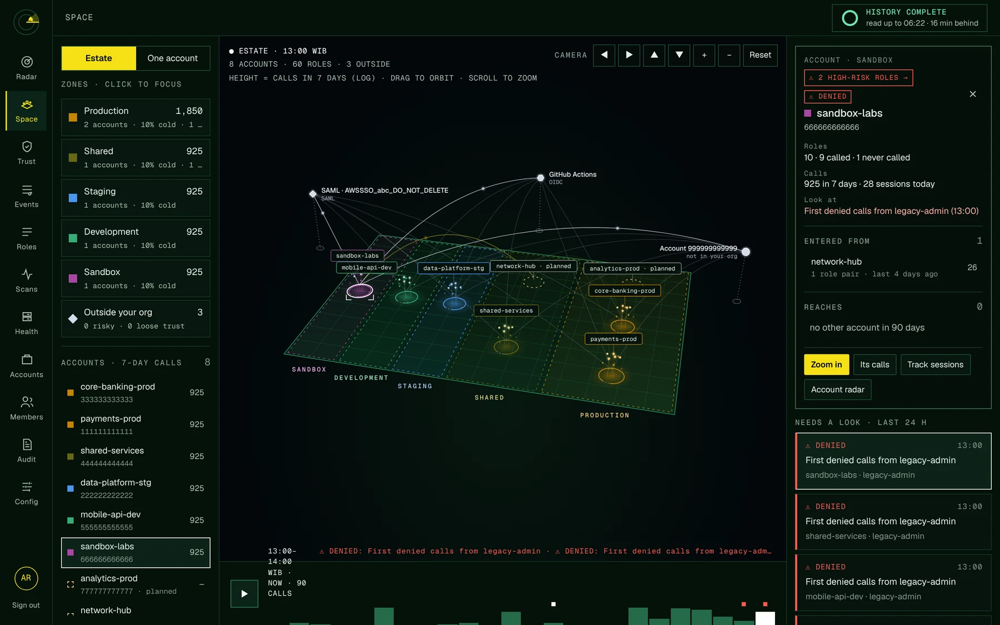
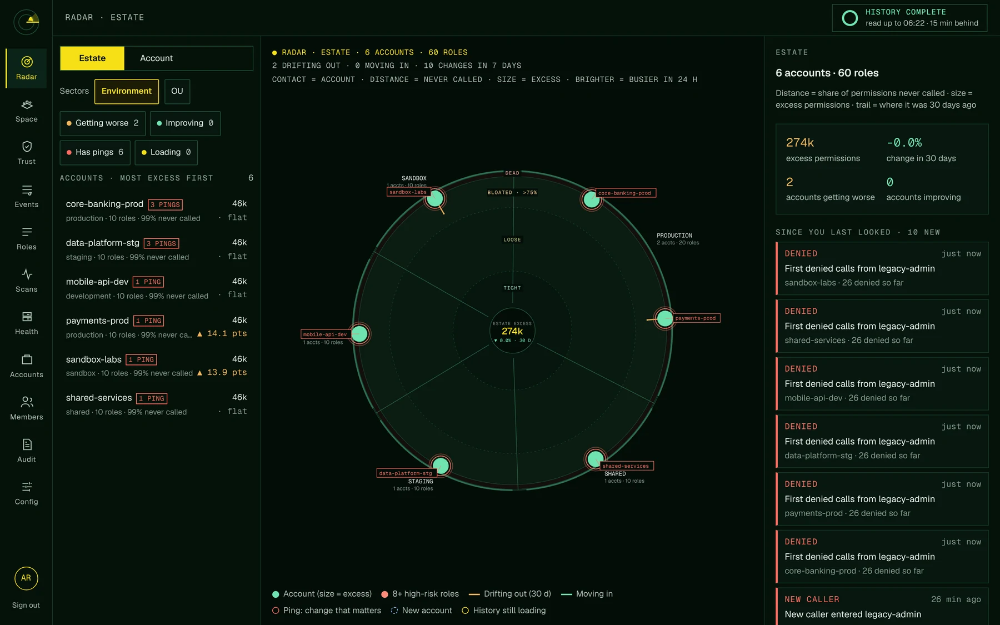
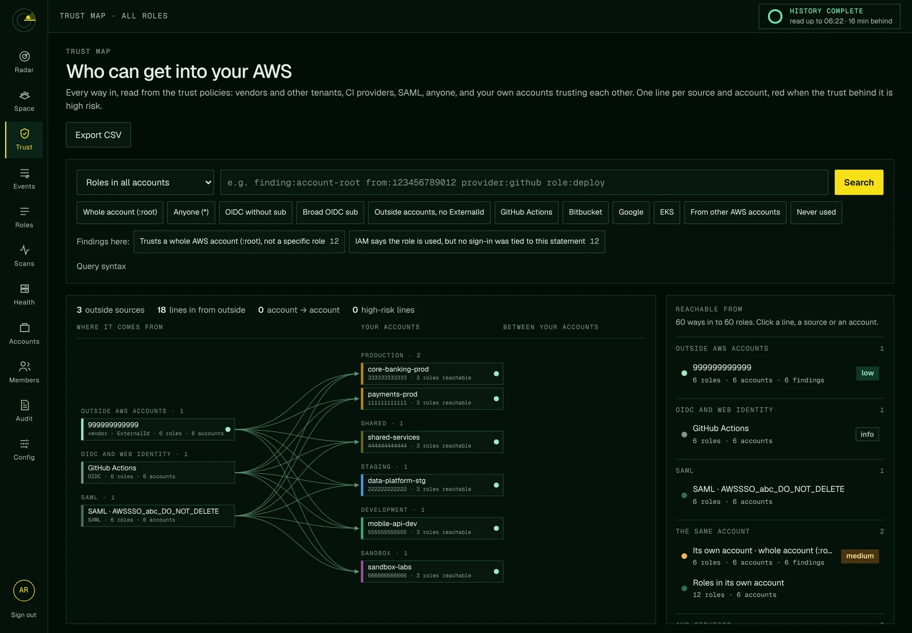
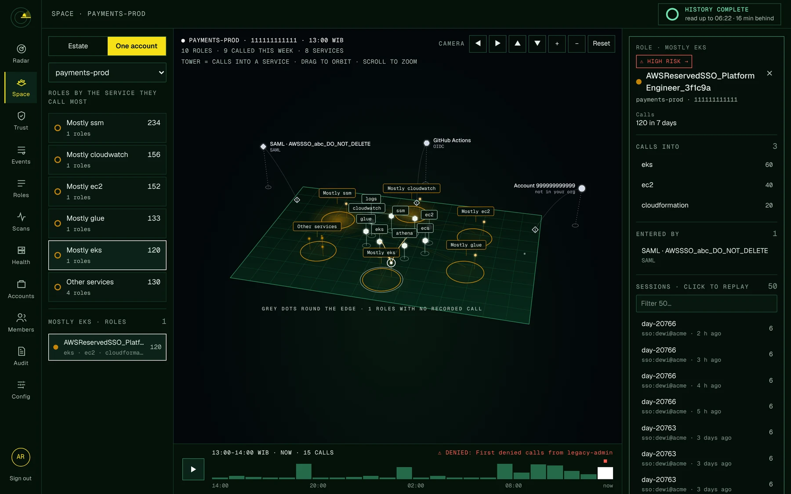
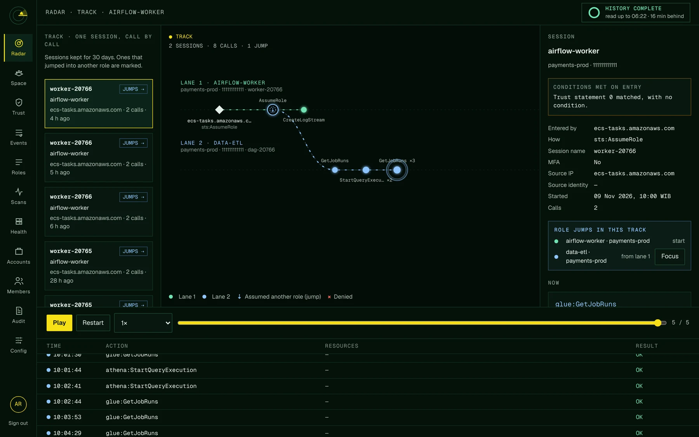
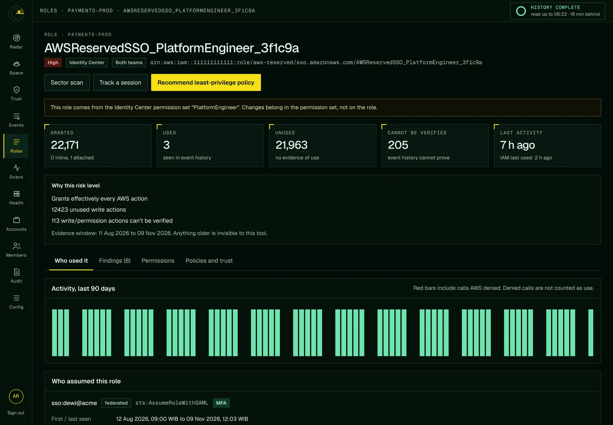
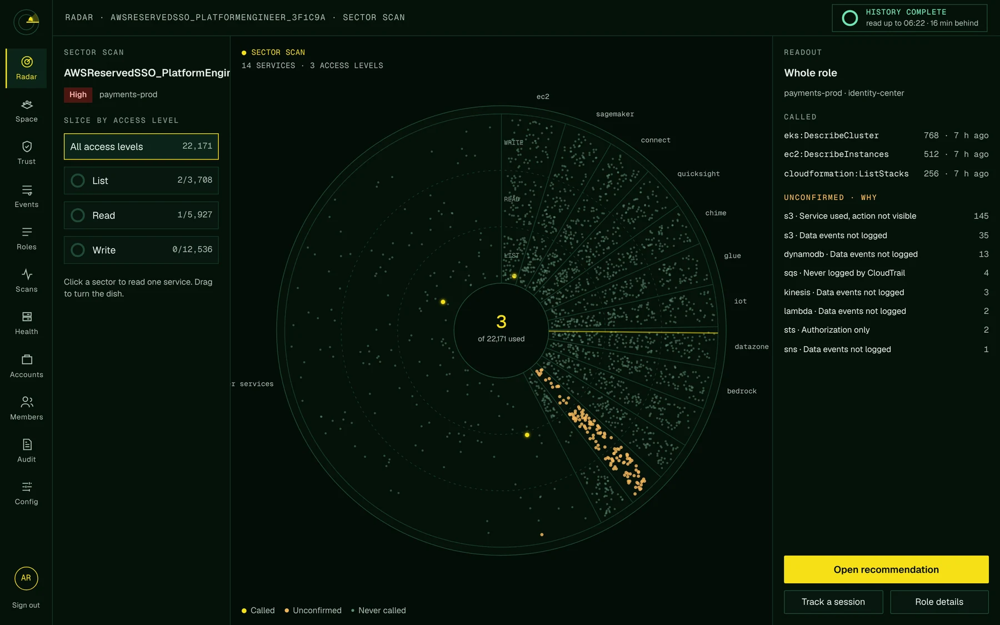
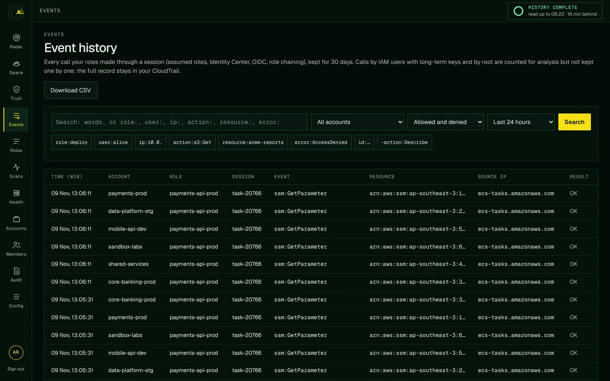
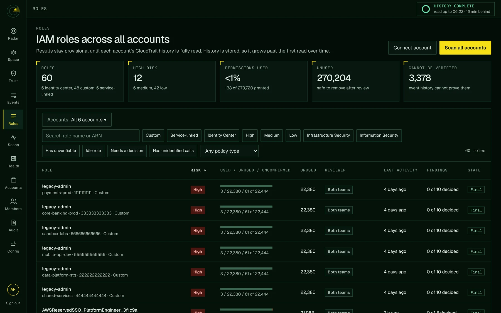
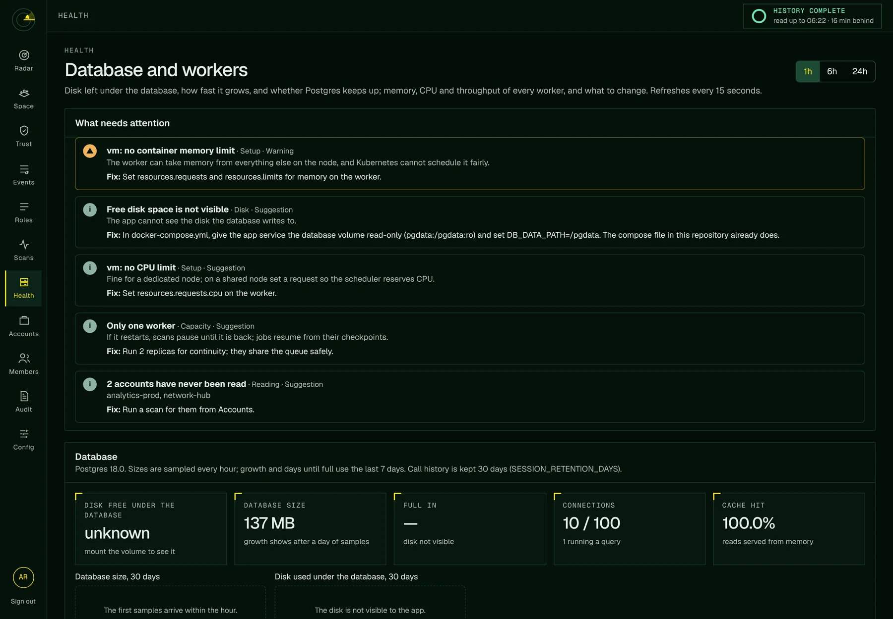

# Curious Monkey

> The monkey only needs a banana. Don't give it a bazooka.

**See what every IAM role in every AWS account really uses, who can get into it, and cut it down to least privilege with evidence.** Self-hosted, read-only, and explicitly denied access to your data.



- **Who used each role, and how they got in.** Every session from CloudTrail: SSO users, CI pipelines, other accounts, AWS services, with the trust-policy conditions they met on the way in.
- **What was really used.** Permissions granted vs. permissions called, per role, over up to 90 days of history (longer from an S3 trail). Anything event history cannot prove is flagged, not silently dropped.
- **Who can get in from outside.** A trust map of every vendor, tenant, CI provider and SAML/OIDC identity that can assume your roles, with the risky ones in red.
- **A least-privilege policy you can trust.** Drafted from the evidence, checked, and approved by your security teams before anyone applies it.
- **Watch it happen.** Replay any session call by call, follow role chaining across accounts, search every call in Event history, and get pinged when something changes.

**Try it in a minute, no AWS account needed:**

```sh
git clone https://github.com/danuesarf/curiousmonkey && cd curiousmonkey
cp .env.example .env
# demo mode, and fresh random secrets for the database, sessions and stored keys
perl -pi -e 's/^AWS_MODE=.*/AWS_MODE=demo/; s/^(POSTGRES_PASSWORD|SESSION_SECRET|DATA_ENCRYPTION_KEY)=$/$1 . "=" . `openssl rand -hex 32`/e' .env
docker compose up -d --build
docker compose exec app node src/cli.js demo     # adds fake accounts and scans them
```

Open http://localhost:8080 and sign up: the first person becomes the owner, and is asked to set up an authenticator app (two-factor is required for anyone who can approve changes).

## A look around

<table>
<tr>
<td width="50%"><a href="docs/screenshots/radar.webp"></a><br><b>Radar.</b> Every account at a glance: distance is how much of its permissions is never used, size is excess, trails show whether it is getting better or worse, pings flag changes that matter.</td>
<td width="50%"><a href="docs/screenshots/trust-map.webp"></a><br><b>Trust map.</b> Who can get into your AWS: outside accounts, vendors, GitHub Actions, Bitbucket, SAML, anyone, and your accounts trusting each other. Red when the trust behind a line is high risk.</td>
</tr>
<tr>
<td><a href="docs/screenshots/space-account.webp"></a><br><b>Space.</b> One account in 3D: roles grouped by the service they call, towers for the services, outside identities at the edge. Click anything for its sessions and replay them.</td>
<td><a href="docs/screenshots/track.webp"></a><br><b>Track.</b> One session, call by call, with every role it jumped into on its own lane, and the conditions it met on entry.</td>
</tr>
<tr>
<td><a href="docs/screenshots/role.webp"></a><br><b>Every role.</b> Granted vs. used vs. unverifiable, why it is high risk, who assumed it with MFA or not, and a one-click least-privilege recommendation.</td>
<td><a href="docs/screenshots/sector-scan.webp"></a><br><b>Sector scan.</b> One role cut into services and access levels: lit dots were called, amber ones cannot be proven, dim ones were never used.</td>
</tr>
<tr>
<td><a href="docs/screenshots/events.webp"></a><br><b>Event history.</b> Search every call your roles made by role, user, IP, action, resource or error, and export it.</td>
<td><a href="docs/screenshots/roles.webp"></a><br><b>Roles.</b> All roles across all accounts, filtered by risk, kind, reviewer team and findings, with a picker that works for hundreds of accounts.</td>
</tr>
<tr>
<td colspan="2"><a href="docs/screenshots/health.webp"></a><br><b>Health.</b> The database and the scanner workers: disk left, growth, memory and what to change.</td>
</tr>
</table>

<sub>Screenshots are of the built-in demo mode: the accounts and identities are made up.</sub>

## Run it

Needs Docker. The scanner runs in its **own container**, so a heavy scan never slows the portal or API.

```sh
cp .env.example .env            # set POSTGRES_PASSWORD, SESSION_SECRET, DATA_ENCRYPTION_KEY (openssl rand -base64 48)
docker compose up --build       # postgres, app (UI + API), worker
```

Open http://localhost:8080 (change `HOST_PORT` in `.env` if the port is taken) and sign up. **The first person to sign up becomes the owner.** After that, sign-up is by invite link only.

Try it without AWS credentials: set `AWS_MODE=demo` in `.env`, then `docker compose exec app node src/cli.js demo`. This adds two fake accounts and queues their first scans.

Kubernetes: `kubectl apply -k deploy/k8s` (copy `secret.example.yaml` to a real secret first). The API and the worker are separate Deployments; scale workers with `replicas`.

## How the scanner works

- Scans are jobs in a Postgres queue (`FOR UPDATE SKIP LOCKED`). Steps: inventory, events (one job per region), Access Advisor, analyze.
- A job holds a 90 s lease, renewed by heartbeat. If a worker dies, the reaper requeues the job and another worker continues from the saved checkpoint. Failures retry with backoff (30 s doubling to 30 min, 5 attempts). Permission errors fail at once and are not retried.
- Event history is read in 6-hour slices. Each slice commits its aggregates and checkpoint together, so a restart never re-reads saved history or double counts. A daily scan reads only what is new.
- CloudTrail Event History keeps 90 days. If the worker is down longer than that, the gap is shown on the account page.
- Monitor everything under **Operations** (Scans: queue, per-job progress, logs, retry, cancel). Prometheus metrics are on the worker at `:8081/metrics`.

## Connecting an account

The **Connect an AWS account** wizard has four steps. Nothing is saved until the last one.

1. **Account**: name, account ID, environment, regions.
2. **CloudTrail source**:
   - **Event History** works out of the box. It covers at most 90 days, holds management events only, and is slow, because AWS allows 2 requests a second (about 100 events a second per region).
   - **S3 trail** reads the trail's log files. It has no request limit, so it usually takes minutes. History goes as far back as the files exist (up to 2 years here), and it includes data events if the trail logs them.
   - The wizard estimates the first scan's duration. Scan activity shows a live ETA while it runs.
3. **Access**:
   - **Assume a scanner role** (recommended). The base identity is either the worker's own credentials (instance, task or pod role, or keys in `.env`) or an access key stored encrypted on the account.
   - **IAM user access key**: the keys of a dedicated read-only user, used directly.
4. **Deploy and connect**: apply the Terraform or CloudFormation template, then connect. You land on Scan activity.

Edit an account at any time. Switching source keeps the stored history. Widening the lookback backfills only the older days. The worker logs which AWS identity it runs as at startup, and the wizard shows it.

## The radar

The portal opens on a **radar** with two views:

- **Estate:** each contact is an AWS account. Distance from the centre is its share of permissions never called; size is its excess permissions (granted minus used). A trail shows where it was 7 and 30 days ago: amber when drifting outward (getting worse), green when moving inward. Brightness is activity: the busier the account in the last 24 hours, the brighter its contact. Pings mark changes that matter. Sectors are environments, or the OU / group you set on each account.
- **Account:** the same for one account's roles, sectored by role kind.

**What changed** comes from two tables. After each final analysis of a fully read account, every role gets a daily snapshot (`role_snapshots`); trails and trends compare against them, so they appear after 7 and 30 days. The same step records changes (`changes`): permissions grew (or reached admin level), trimmed, first denied calls, went 90 days without calls, new roles, new unidentified event names. A caller seen entering a role for the first time is recorded while events are read. Nothing is recorded during an account's first read, when everything would look new. There is one change feed. Radar lists it for a range (`?feed=1|7|30|90` days, 7 by default) and marks what is new to you; the bell in the top bar shows only what is new to you, with *Mark all as seen*. "New" means recorded after you last looked (by change id, since a new caller can be found in older history), and opening the estate on Radar counts as looking. In demo mode, `node src/cli.js demo-history` invents 35 days of snapshots and a few changes so this can be seen at once.

- **Sector scan** (the top of an identity's *Permissions* tab) cuts one role into rings (access level) and sectors (service). Lit dots were called, amber dots are unconfirmed, dim dots were never called.
- **Track** replays one role session call by call. Each session is a lane. When a session assumes another role (role chaining), the call is drawn as a jump into a new lane for the new session, linked by access key. Chains across connected accounts are linked too. Sessions in accounts you can't see are counted, not shown. Session replays are kept for `SESSION_RETENTION_DAYS` (default 30). Space opens the same replay over the map: a role's sessions are listed in its sidebar (click one to replay it), and **Track sessions** on a role, an account or an account-to-account path lists theirs.

### Results while history is still loading

The radar and role pages show data as soon as the first slices are read. Until an account's history is fully read, its results are marked **provisional**: used counts are "at least", never-called counts are "at most". The status bar shows how much is read and the time left. A provisional analysis runs every `PROVISIONAL_EVERY_SECONDS` (default 300). **Approval is blocked until history is complete.**

## Keeping up between scans

Two separate questions, two separate answers in the status bar:

- **History** (the dial): has each account's whole lookback been read? It fills once, then says *History complete* and stays that way.
- **Freshness** (the line under it): how current is the data? *read up to 14:05 · 12 min behind*, for the least current account. Green while it is within two catch-up intervals, amber after that, red after a day and a half. Each account's own freshness is on the Accounts page.

The daily scan (`SCAN_AT`, 01:00 `SCAN_TZ`) reads everything: roles, policies, Access Advisor, new CloudTrail events. Between daily scans, **catch-up reads** run every `TAIL_EVERY_MINUTES` (default 30; Configuration › *Read new events every*; 0 turns them off). A catch-up read is an events job per region plus an analysis, for accounts whose history is complete and that have no scan in flight. It reads only what arrived since the last read, so a quiet account costs one CloudTrail call per region, and the analysis is skipped when nothing new arrived. Inventory, Access Advisor and the daily change snapshot wait for the daily scan. Catch-up reads stay out of the Scans list unless one fails; finished ones are deleted after two days.

CloudTrail delivers events 5 to 15 minutes late and reads hold back `SCAN_DELIVERY_LAG_MINUTES` (15), so data is at best about 15 minutes behind. An interval shorter than about 5 minutes only adds AWS calls.

## Identities

**Identities** in the rail (`#/identities`) is one list with a switch at the top: *Roles*, *IAM users* and *Google Cloud*. Each keeps its own filters in the address.

Whatever you open, a role, an IAM user or a Google Cloud identity, lands on one page (`#/identities/<id>`) with tabs; the tab is in the address (`?tab=`), so a link opens it:

- **Overview:** the numbers, why it has its risk level, who got in, and its paths to the other cloud.
- **Activity:** calls per day for 90 days, who assumed it with the conditions they met, and its sessions. Picking a session replays it call by call in a window (Track).
- **Permissions:** the sector scan on top, then services and every action with its status. Clicking a sector filters the list under it.
- **Credentials** (IAM users, Google service accounts): access keys, console sign-in and MFA; for Google Cloud, keys and everything that can run as it.
- **Policies and trust:** the documents.
- **History:** what changed on it, newest first: policies attached, detached or edited (with a diff of the document), trust policy and boundary changes, risk level changes, keys created, deactivated or deleted, MFA and console password changes, new callers, and every decision and approval with who made it. Policy, trust, credential and risk changes are compared at each scan from this version on; key dates, callers and decisions come from their own records, so they go back further.
- **Findings:** the same cards as the Findings inbox, decided in place.

Tabs that do not apply are left out (Google Cloud has no Activity: its audit logs are not read). Old addresses (`#/roles`, `#/roles/<id>`, `#/roles/<id>/scan`, `#/users`, `#/users/<id>`, `#/gcp/principals/<id>`) open the new ones.

## Search

Press `Ctrl K` (`⌘ K` on a Mac) on any page, or use **Search** in the top bar, and type a role, an IAM user, an access key ID, an account name or ID, a Google Cloud identity or a page name. Arrows move, Enter opens, Esc closes. Results only come from the accounts you can see.

## IAM users

IAM users are watched alongside roles. **Identities → IAM users** lists every user with each access key on its own line: the key ID, Active or Inactive, its age, when and where it was last used, and badges when it should be rotated (older than 90 days) or deactivated (never used, or not in 90 days). Secret keys are never readable, here or in AWS; only their IDs are shown. The list also shows console passwords and MFA, groups, calls in the last 7 days and the findings behind the risk level, with filters for old keys, unused keys, two active keys, console without MFA and inactive users.

A user opens on the same identity page as a role, with a *Credentials* tab. It adds the keys' CloudTrail activity (calls, first and last seen, source IPs), who used it in the last 30 days (each key, and console or temporary sessions separately), the roles it assumed, and its own and its groups' policies. **Permission analysis** is the same page as for a role: granted, used, never used.

Radar and Space have a **Show: All | Roles | IAM users** switch. Users are drawn as squares in Space and sit in their own sector on the account radar.

Risk adds to the usual permission findings: an active key older than 90 days, a key never used or idle for 90 days, two active keys, a console password without MFA or never used, and console access alongside keys.

The scanner reads users with `iam:ListUsers`, `iam:ListAccessKeys`, `iam:GetAccessKeyLastUsed`, `iam:ListMFADevices`, `iam:GetLoginProfile`, `iam:ListGroupsForUser`, `iam:ListUserPolicies`, `iam:GetUserPolicy`, `iam:ListAttachedUserPolicies` and the group policy reads; these are in the generated scanner policy. A scanner role without them keeps working: users are skipped with a warning in Scan activity, and users already stored are kept until they can be listed again.

## Space

`#/space` shows the estate as a tilted plane, replayed hour by hour over the last 24 hours (WIB).

- **Estate:** the plane is your organization, split into zones by environment (production, shared, staging, development, sandbox, each one colour). Each account is a ring with one star per busy role: higher and brighter = more calls in 7 days. Roles never called lie grey on the floor; the dashed grey part of a ring is that share. Identities outside the org that trust policies let in (other accounts, OIDC, SAML, `*`) float off the plane, placed by the trust map's worst finding: close and low = risky, far and high = pinned. Role chaining between accounts (a session whose parent session is in another connected account) arcs above the plane and lights up in the hours it happened; a pair first seen today is a white dashed NEW PATH. Changes from the feed mark the hour they happened on the bar.
- **One account:** the services the account calls stand as towers in the middle (taller = more calls in 7 days); roles cluster round the service they call most; accounts that chain in or out sit just past the edge; roles never called ring the floor.

Click anything for a card beside it; links go on from the card. Paths and their tags can be clicked too: a trust path shows the role it reaches, why the trust is flagged, who it trusts and on what conditions, and whether it was ever used. Drag or use the camera buttons to orbit; scroll or use + and − to zoom. The scale never changes on its own. Hours come from `track_sessions` (calls are counted in the hour their session started), heights from `activity_daily`. Red always means a problem and always carries a ⚠ tag.

A cross-account AssumeRole appears in the target account's CloudTrail with no ARN, only `userIdentity { type: AWSAccount, accountId, principalId }`. The scanner keeps the caller's account (principal key `acct:<account>:<unique id>`) so the path still draws, and when the caller's account is connected it names the role from its IAM unique ID (`roles.aws_id`, filled by the inventory scan) so it counts as `role:<account>:<name>` and matches role-ARN trust. Callers recorded before this change sit together under one `other:AWSAccount` principal and cannot be split.

**Curious Monkey** (the portal itself) is drawn as its own identity, a brown monkey face: above the account its worker identity lives in when that account is connected, off the plane otherwise. Dotted paths go to the scanner role (each account's `role_arn`) in every account it reads, lit in the hours it signed in; its sign-ins are kept out of the account-to-account paths. It is recognised by the workers' AWS identity (`workers.aws_identity`, or `SCANNER_PRINCIPAL_ARN`) and by the `curious-monkey` session name. Click it for every account it reads, the role, sign-ins and last scan.

## Operations: Workers and Database

`#/operations/workers` and `#/operations/database` (the **Operations** item in the rail, needs the `ops` permission) show the workers and the database, each with its own list of what needs attention.

- **Database:** free disk under Postgres, database size and its growth a day, days until the disk is full at the last 7 days' rate, connections, cache hit rate, the largest tables with their dead rows and last vacuum, the longest running query, idle open transactions and transaction ID age. Warnings start at 80% disk used or under 45 days to full; critical at 90% or under 14 days.
- **Free disk:** Postgres cannot see it. The compose file mounts the database volume read-only into the app container at `/pgdata` and sets `DB_DATA_PATH=/pgdata`; the app reads free space from it and reads nothing else. Without the mount the page says the disk is not visible. On Kubernetes, mount the database's volume the same way or leave it unset.
- **History:** the app samples sizes every hour into `db_samples` (90 days kept), so growth needs about a day of samples before it shows.
- If the disk gets tight, `SESSION_RETENTION_DAYS` is the main lever: call history (`track_calls`, `track_sessions`) is usually most of the database.

## Event history

`#/events` searches every call your roles made through a session (assumed roles, Identity Center, OIDC, role chaining), kept for `SESSION_RETENTION_DAYS` (default 30). Calls by IAM users with long-term keys and by root are counted for analysis but not kept one by one; raw CloudTrail records are never stored.

Search with plain words, or keys: `role:`, `user:` (session name or caller), `ip:`, `action:`, `event:`, `resource:`, `error:`, `id:` (CloudTrail event ID), `key:` (access key), `agent:`. A leading `-` leaves matches out: `role:deploy -action:Describe`. Filter by account, denied or allowed, and time range; every filter is in the URL, so a search can be shared. Open a row for the full event and links to its session replay, the role, the same IP or the same event. **Download CSV** exports up to 5,000 matching calls and is recorded in the audit log.

## Planned accounts

An account can be added before anyone deploys the scanner role in it: **Accounts → Add planned account**, one at a time or pasted one per line (`account ID, name, environment, OU`). A planned account has no access settings and is never scanned or counted in the history bar. It shows on Space as a dashed ring, and the trust map counts it as one of yours, so trust from it is no longer shown as coming from outside the org. **Onboard** runs the usual connect wizard with its details filled in, then verifies it.

## Trust map

**Trust** in the rail shows who can get into your AWS, read from the trust policies, as a 2D map:

- **Left:** where it comes from, grouped: anyone, outside AWS accounts (vendors and other tenants, marked *vendor · ExternalId* when every statement requires `sts:ExternalId`, otherwise *no ExternalId*), OIDC providers, SAML, deleted identities.
- **Middle:** your accounts, grouped by environment. One line per source → account however many roles are behind it: red when the worst trust behind it is high risk, amber when medium, green otherwise; dashed when never seen used; thicker with more roles.
- **Right:** arcs between your own accounts (A trusts into B), one per direction, coloured the same way.
- Click a line for the roles it can assume (worst first, with findings, conditions and whether it was used), a source for the accounts it can get into, or an account for who can get in and what it can get into. The selection is kept in the URL (`sel=`), **Filter to this** turns it into a query, and the **Ways in** list below follows it, 20 rows a page.
- Trust from inside the account itself and from AWS services is not drawn: it is counted on each account and listed in the sidebar under *Reachable from*.

Each way in (statement × principal) is one row of **Ways in**, with:

- where it comes from: the same account, your other connected accounts, AWS accounts outside your estate, OIDC (GitHub Actions, Bitbucket Pipelines, GitLab, EKS service accounts, Terraform Cloud…), SAML, Google, AWS services, or anyone;
- the conditions on the way in, and what was actually seen coming in through it;
- findings: trusts a whole account (`:root`) instead of a role; principal `*` or `NotPrincipal`; an account outside your estate with no `sts:ExternalId`; OIDC with no `sub` condition, or a broad wildcard `sub`; no `aud`; SAML with no `SAML:aud`; an IAM user; a deleted identity; `sts:*`; never used.

Everything is a query, so a view is a shareable link and a CSV export:

```
finding:account-root                      roles that trust a whole account
from:123456789012                         roles that trust that account (or a connected account's name)
account:payments-prod source:oidc         OIDC ways into one account's roles
provider:github finding:oidc-broad-sub    GitHub Actions trust with a wildcard subject
source:external -cond:ExternalId          outside accounts with no ExternalId condition
role:deploy has:findings used:no          …
```

Keys: `account` `from` `source` `type` `provider` `finding` `severity` `role` `roleid` (one role exactly) `cond` `env` `has` `no` `used`; prefix `-` to exclude; anything else is free text.

The Trust map is the one full list of who can get in. Space's panels and a role's Overview show the top few, worst first, with a link to the Trust map filtered to that account or role.

## Google Cloud

Connect a Google Cloud organization, folder or project on the Accounts page, *Google Cloud* tab (*Connect Google Cloud*). Accounts and Roles both have an *AWS | Google Cloud* tab; connections are only managed on Accounts. Curious Monkey reads IAM only: the hierarchy, every IAM policy (organization, folders, projects, service accounts), service accounts and their user-managed key metadata, custom and predefined role definitions, and workload identity pools and providers. **Audit logs are not read yet**, so Google Cloud shows what each identity *can* do and where it can come from, not what it used.

- **Sign-in:** workload identity federation from this app's own AWS role (recommended: no Google secret is stored; the provider's attribute condition pins it to that one role), or a service account key (stored encrypted). The page generates the `gcloud` commands: a custom role `curiousMonkeyReader` with 18 read permissions (`roles/iam.securityReviewer`, `roles/browser` and `roles/iam.workloadIdentityPoolViewer` for a folder, which cannot hold custom roles), the reader service account, and the pool and AWS provider. *Test connection* signs in and reads the scope before saving.
- **Scans:** a worker reads each due connection every 24 hours (*Scan now* to run it sooner). Each scan replaces the previous snapshot in one transaction; a failed scan keeps the last good one and retries in an hour.
- **Analysis:** roles are inherited down the hierarchy and their permissions combined. For every service account it lists who can become it: key holders, Token Creator and similar (impersonation), Service Account User (`actAs`), key creators, GKE workload identity and federated identities. Findings: Owner and Editor, the right to change IAM policy, impersonating every service account in a project or folder, old or never-expiring keys, the default compute service account with Editor, users outside your domain, `allUsers`, bindings to deleted identities, and federation pools with no attribute condition. Group membership is not expanded and IAM conditions are shown but not evaluated.
- **Identities page:** a *Google Cloud* list beside *Roles* and *IAM users*. It lists identities riskiest first, filtered by kind, risk, project and way in (keys, federated, from AWS, impersonated, GKE). One identity shows what it can do (each role, where it is granted, how many projects it reaches, the full permission list), where it can come from, who it can become, and its paths to and from AWS.
- **Across clouds:** AWS roles that can act in Google Cloud (an AWS provider plus a binding to `attribute.aws_role` or the whole account), and AWS roles that trust a Google service account (`accounts.google.com` with its unique ID in `:sub`, `:aud` or `:oaud`). Both show on the AWS role's page and the Google identity's page, and the Trust map names the service account.
- **Space:** with Google Cloud connected, the estate shows two fields. AWS is the green plane at the back and Google Cloud the blue plane in front, with the same environment zones. A project is a ring and each service account a dot, higher the more it can do and red when it is high risk. Blue arcs between the planes are paths between the clouds; a red arc means any role in that AWS account can use it. Click a project or an arc for the details.
- **Environments:** a project lands in the environment set for it on the Accounts page, otherwise its `env`/`environment` label, otherwise the connection's default.
- Members limited to some AWS accounts do not see Google Cloud.

## Access reviews

**Reviews** in the rail (`#/reviews`, Access reviews) gives you evidence for a periodic user access review (UAR). *New review* (owners, admins, reviewers) takes the accounts and a period you pick and freezes, in one consistent read:

- every role and IAM user, with its risk and why, permissions granted, used and unused;
- who used it in the period, how many calls and on how many days;
- IAM users' access keys (age, last use, due for rotation), console password and MFA;
- every open finding with its decision, who made it and their team.

Later scans do not change a review. Each review team listed on it signs it off once (members with the `approve` permission and a team), with an optional note; the name, email and time are kept. A signed-off review cannot be removed. Download it as **Identities CSV** (one line per identity) and **Decisions CSV** (one line per finding), or **Print or save as PDF** for a report with the sign-offs, totals and every identity.

The **Roles** and **IAM users** lists also download as CSV with their current filters (*Download CSV*; IAM users have one line per access key). Cells that a spreadsheet would run as a formula are escaped.

## Alerts

**Admin → Alerts** (`#/admin/alerts`, owners and admins) posts to Slack or any HTTPS webhook so nobody has to keep the app open. Add a **destination** (a Slack Incoming Webhook URL, or a webhook such as n8n or a SIEM; the URL is stored encrypted and never shown again) and send it a test. Then add **rules**:

| When | Posts |
|---|---|
| New finding | a finding at or above the severity you pick |
| Radar change | the changes Radar pings, by kind and severity: a new caller entered a role, a role gained permissions, first denied calls… |
| Access key past its rotation age | an active key older than the rotation age (below) |
| Console password without MFA | an IAM user who can sign in to the console without MFA |
| Scan failed | a scan job that failed with no retry left |

Each rule can be limited to some environments, and posts either at once (checked every minute) or as a daily digest at `ALERT_DIGEST_AT` (09:00, in `SCAN_TZ`). Everything a rule finds together goes out as one message (up to 50 lines, then a count and a link). Events count only from when the rule was created or switched on, so a new rule does not post the backlog; conditions (an old key, no MFA) post what is true now once, and again only if they clear and come back. A message that fails is retried once two minutes later; the log on the page shows each one. The worker runs the rules; any number of workers can run, one evaluates at a time.

A webhook receives `{ source, kind, title, rule, count, items: [{ title, subject, account, environment, severity, url, at }], more, sentAt }`. In production, URLs must be https and may not point at loopback or the cloud metadata service; redirects are not followed. The worker needs egress to `hooks.slack.com` (or your webhook's host).

**Risk thresholds** (Admin → Configuration, or `KEY_ROTATE_DAYS` / `KEY_UNUSED_DAYS`): when an access key should be rotated (90 days by default; Google Cloud service account keys too) and when an unused key or console password should go. The IAM users list follows a change at once; risk levels follow at each identity's next analysis.

## Findings

**Review → Findings** (`#/findings`) lists every open finding on the roles and IAM users you can see, so a reviewer works through one queue instead of opening each role. It opens on what *Needs a decision*, most severe first; the rail shows how many wait. Filter by severity (the tiles), type, account, roles or IAM users, and *My team's* (the roles your review team signs off, plus those both teams must); every filter is in the address, so a filtered queue can be shared. Pick a finding to see its evidence and decide beside the list. Tick several to decide them at once with one note, or to clear their decisions. A bulk decision is all or nothing: findings that take different decisions (keep / remove for an action, accept / investigate for the rest) must be decided separately. Each decision is recorded per finding, with the reviewer and team, exactly as on the role page.

Keys: `j` / `k` move, `x` selects, `1`–`3` decide the selected findings (or the open one), `Esc` unselects, `/` searches.

## Unidentified calls

Each account has an **Unidentified calls** page. It accounts for every CloudTrail event read: role sessions, role calls, and events outside scope (IAM users, root, services, roles the account doesn't have). It also covers three cases that need care:

- **Role found by name:** some events have no `sessionIssuer`, so the role is recovered from the session ARN.
- **Unidentified event names:** CloudTrail event names don't always match IAM action names. Known mismatches are handled, including versioned names like `GetDistribution2020_05_31`.
  - Calls under an unknown name are kept under the raw name, and the rest of that service stays *unconfirmed*, never *unused*. The draft holds those permissions back and says so.
  - Settle each name in one of four ways: type the action, **Ask Bedrock** (`BEDROCK_ENABLED=true`; a reviewer accepts each suggestion, and only real IAM actions are accepted), **No permission**, or **Can't resolve** with a note. A can't-resolve name reopens after 30 days if it is still being called.
  - A decision applies to every account and credits history already stored. No rescan is needed, only a re-analysis. The same panel opens from a role (**Identify**).
- **Calls that named no resource:** CloudTrail fills in `resources` for some events only. If any call of an action named no resource, the draft keeps that action's granted resources instead of narrowing to the ones seen, and the replay check enforces it.

Only event names and request parameter *names* are kept, never parameter values.

## Access

Roles: owner, admin, reviewer, account owner, auditor. Reviewers belong to Infrastructure Security or Information Security. Identity Center roles go to Information Security, service-linked roles to Infrastructure Security. High-risk roles need both teams. Everything can be limited to some accounts. Sign-in uses scrypt passwords, TOTP two-factor (required for privileged roles) and an audit log.

**Forgotten passwords.** An owner opens Members → *Reset password* and gets a single-use link to send the member (nothing is emailed). It expires in 24 hours, a newer link cancels it, and the current password keeps working until it is used. Using it signs the member out everywhere and can also reset their two-factor if they lost their authenticator. The token sits after the `#`, so it never reaches server or proxy logs; only its hash is stored.

**Single sign-on (OIDC).** Owners set it on Configuration → *Single sign-on*, or with the `OIDC_*` environment variables (a setup saved in the portal overrides them). The JumpCloud preset fills in the issuer for your region, the scopes (`openid email profile`) and the group claim; paste the client ID and secret from a JumpCloud *Custom OIDC App* whose redirect URI and login URL are the two addresses the page shows, with *Include group attribute* on and named `groups`. *Check issuer* reads the provider's discovery document before you save. Map IdP groups to roles in the same card; someone in no mapped group is turned away. The client secret is stored encrypted and never shown again. Password sign-in keeps working as the way back in.

## Security checks

Every push, pull request and Monday morning, `.github/workflows/security.yml` runs:

| Job | Tool | Fails on |
|---|---|---|
| test | `npm test` | any failing test |
| deps | `npm audit`, Trivy filesystem scan (vulnerabilities, secrets, misconfiguration) | moderate+ npm advisories; fixable HIGH/CRITICAL |
| sast | Semgrep security packs (JavaScript, Node, Express, XSS, secrets, Dockerfile, Kubernetes, GitHub Actions, insecure transport) | WARNING or ERROR |
| secrets | Gitleaks over the whole git history | any leak |
| iac | Checkov (Dockerfile, `deploy/k8s`, workflows) | any failed check |
| image | Trivy on the built image (Alpine packages and `node_modules`) | fixable HIGH/CRITICAL |

Findings also go to the Security tab (code scanning) where the repository has it. Run the same locally with `npm run security` (each tool is skipped if not installed; `npm run security -- semgrep` runs one). Dependabot keeps npm packages (pinned to exact versions), the base image and the Actions (pinned to commit SHAs) current.

Reviewed exceptions live next to the tool, each with its reason: `.checkov.yaml`, `.gitleaksignore`, and `nosemgrep:` comments in the code.

## What it does not do (be aware)

- It never changes your AWS accounts. Approved policies are exported as JSON or Terraform for you to apply.
- Data events (S3 objects, DynamoDB items) are not in Event History. Those permissions show as *unconfirmed*, not unused. Data-event source discovery is informational.
- Not built: SAML, SCP analysis, pull request creation, email delivery of invites (the invite is a link you send).
- Google Cloud: no audit logs yet (permissions only), groups are not expanded, IAM conditions and deny policies are not evaluated, resource-level policies below service accounts (buckets, datasets) are not read.
- Not tested against live services: the real AWS SDK paths, the real Google Cloud APIs, OIDC sign-in, and live Bedrock. Everything else is covered by tests run on a real Postgres with a built-in fake AWS estate (`npm test`).

## Develop

```sh
npm ci
npm test                        # needs the postgres binaries from embedded-postgres; run as a non-root user
npm start & npm run worker
```

## License

MIT. See [LICENSE](LICENSE).
